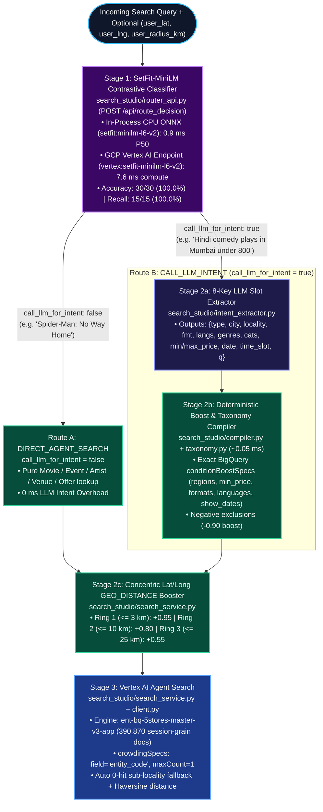

# Entertainment Agent Search — SetFit Classifier $\rightarrow$ Conditional LLM $\rightarrow$ Vertex AI Search

Production architecture for **Entertainment Discovery (`movie`, `event`, `venue`, `artist`, `offer`)** powered by a **3-Stage Real-Time Query Pipeline**:

1. **Stage 1 — SetFit-MiniLM Query Decision Classifier ([`search_studio/router_api.py`](./search_studio/router_api.py))**:
   Classifies every incoming search query in **`0.9 ms` P50** on CPU (`sentence-transformers/all-MiniLM-L6-v2` ONNX + 128-d Contrastive Projection Head + 7 Facet Heads) into:
   - **`DIRECT_AGENT_SEARCH` (`call_llm_for_intent = false`)**: Pure movie/event title, artist, venue, or bank offer lookup $\rightarrow$ bypasses LLM intent extraction (`0 ms` LLM overhead) and queries Vertex AI Agent Search directly.
   - **`CALL_LLM_INTENT` (`call_llm_for_intent = true`)**: Query contains city/locality, price, date/time, format/seating, language, genre/category, or negation filters $\rightarrow$ invokes Stage 2.
2. **Stage 2 — Conditional 8-Key LLM Intent Extractor & Deterministic Boost Compiler ([`search_studio/intent_extractor.py`](./search_studio/intent_extractor.py) + [`search_studio/compiler.py`](./search_studio/compiler.py) + [`search_studio/taxonomy.py`](./search_studio/taxonomy.py))**:
   Executed **only** when `call_llm_for_intent == true`. Extracts a compact 8-key JSON slot dictionary and deterministically compiles exact BigQuery/Vertex `conditionBoostSpecs` + 3-ring Concentric `GEO_DISTANCE` proximity boosts in `0.05 ms`.
3. **Stage 3 — Vertex AI Agent Search Execution ([`search_studio/search_service.py`](./search_studio/search_service.py))**:
   Executes the search against the 5-Store Session-Grain Discovery Engine (`ent-bq-5stores-master-v3-app`, `390,870` documents) with entity deduplication (`crowdingSpecs` on `entity_code`), automatic 0-hit sub-locality fallback, and Haversine distance scoring.

> **Historical Experiments Archive:** All prior router and schema experimentation (Gemma 3 `1B`/`270M` local & Vertex vLLM router benchmarks, `gemini-3.5-flash-lite` router comparisons, and `v2` vs `v3` schema evolution) is archived in [`archive/experiments_v1/`](./archive/experiments_v1/):
> - [`archive/experiments_v1/ROUTER_EXPERIMENTS_EXECUTIVE_SUMMARY.md`](./archive/experiments_v1/ROUTER_EXPERIMENTS_EXECUTIVE_SUMMARY.md)
> - [`archive/experiments_v1/README_experiments_v1.md`](./archive/experiments_v1/README_experiments_v1.md)
> - [`archive/experiments_v1/README_search_studio_experiments_v1.md`](./archive/experiments_v1/README_search_studio_experiments_v1.md)

---

## 1. End-to-End Production Architecture



---

## 2. Repository Structure

| File / Directory | Purpose |
| :--- | :--- |
| **[`realtime_test_webapp.py`](./realtime_test_webapp.py)** | Entrypoint that launches the FastAPI + Uvicorn Search Studio server on `http://127.0.0.1:8080`. |
| **[`train_setfit_router.py`](./train_setfit_router.py)** | Contrastive training script for the **SetFit-MiniLM (`all-MiniLM-L6-v2`)** router (~3.5s on Apple Silicon), exporting [`search_studio/setfit_minilm_router_weights.npz`](./search_studio/setfit_minilm_router_weights.npz) (`672.8 KB`). |
| **[`search_studio/`](./search_studio/README.md)** | Core production package: [`router_api.py`](./search_studio/router_api.py), [`intent_extractor.py`](./search_studio/intent_extractor.py), [`compiler.py`](./search_studio/compiler.py), [`taxonomy.py`](./search_studio/taxonomy.py), [`search_service.py`](./search_studio/search_service.py), [`client.py`](./search_studio/client.py), [`prompts.py`](./search_studio/prompts.py), [`server.py`](./search_studio/server.py), and [`ui.html`](./search_studio/ui.html). |
| **[`cloud_run_api/`](./cloud_run_api/)** | Headless FastAPI container deployed to **GCP Cloud Run (`asia-south1`)** and **Vertex AI Online Prediction (`setfit-minilm-router-asia-south1`)** with baked-in ONNX model & SetFit weights. |
| **[`config.py`](./config.py) & [`config.example.json`](./config.example.json)** | Environment & gitignored `config.local.json` configuration loader (zero hardcoded project IDs or secrets). |
| **[`setup_5stores_master_v3_global.py`](./setup_5stores_master_v3_global.py)** | Builds the BigQuery session-grain master table (`ent_5stores_master_v3`) and provisions the Vertex AI Agent Search engine (`ent-bq-5stores-master-v3-app`). |
| **[`archive/`](./archive/)** | Archived experimentation scripts, legacy schemas, and historical benchmark reports ([`archive/experiments_v1/`](./archive/experiments_v1/)). |

---

## 3. Stage 1: SetFit-MiniLM Decision Classifier (`/api/route_decision` & Vertex `/predict`)

### 3.1 Performance Summary (30-Query Benchmark)

| Router Mode (`model` param) | Execution Target | `include_reason` | Min | Mean | P50 (Median) | P90 | P95 | `CALL_LLM_INTENT` Recall | Total Accuracy |
| :--- | :--- | :---: | :---: | :---: | :---: | :---: | :---: | :---: | :---: |
| **`setfit:minilm-l6-v2`** *(Default)* | In-Process CPU ONNX (Cloud Run / Local) | `false` | **0.8 ms** | **0.9 ms** | **0.9 ms** | **1.1 ms** | **1.3 ms** | **15/15 (100%)** | **30/30 (100%)** |
| **`setfit:minilm-l6-v2`** *(Default)* | In-Process CPU ONNX (Cloud Run / Local) | `true` | **0.8 ms** | **0.9 ms** | **0.9 ms** | **0.9 ms** | **0.9 ms** | **15/15 (100%)** | **30/30 (100%)** |
| **`vertex:setfit-minilm-l6-v2`** | GCP Vertex AI Endpoint (`asia-south1`) | `true` / `false` | **6.3 ms** *(on-VM)* | **8.1 ms** *(on-VM)* | **7.6 ms** *(on-VM)*<br>`22.8 ms` *(RPC)* | **11.7 ms** *(on-VM)* | **13.2 ms** *(on-VM)* | **15/15 (100%)** | **30/30 (100%)** |

---

### 3.2 `curl` Examples to Query the Classifier

#### A. Query the Deployed GCP Vertex AI Endpoint Directly (`asia-south1`)
```bash
# 1. With detailed facet reason ("include_reason": true)
curl -s -X POST \
  -H "Authorization: Bearer $(gcloud auth print-access-token)" \
  -H "Content-Type: application/json" \
  "https://asia-south1-aiplatform.googleapis.com/v1/projects/<PROJECT_NUMBER>/locations/asia-south1/endpoints/1848149303919378432:predict" \
  -d '{
    "instances": [
      {
        "query": "Hindi comedy plays in Mumbai this Sunday under 800",
        "include_reason": true,
        "use_cache": false
      }
    ]
  }' | jq .

# 2. Fast route-only mode ("include_reason": false)
curl -s -X POST \
  -H "Authorization: Bearer $(gcloud auth print-access-token)" \
  -H "Content-Type: application/json" \
  "https://asia-south1-aiplatform.googleapis.com/v1/projects/<PROJECT_NUMBER>/locations/asia-south1/endpoints/1848149303919378432:predict" \
  -d '{
    "instances": [
      {
        "query": "Spider-Man: No Way Home",
        "include_reason": false,
        "use_cache": false
      }
    ]
  }' | jq .
```

**Response (`include_reason: true`):**
```json
{
  "predictions": [
    {
      "status": "OK",
      "query": "Hindi comedy plays in Mumbai this Sunday under 800",
      "call_llm_for_intent": true,
      "route": "CALL_LLM_INTENT",
      "recommended_nlu_mode": "llm_boost",
      "reason": "SetFit-MiniLM (99.9% conf): Has city/locality, date/time, price range, language, genre/category filters",
      "confidence": 0.9991,
      "router_model": "setfit:minilm-l6-v2",
      "router_display_model": "SetFit-MiniLM-L6-v2 (Contrastive ONNX Classifier)",
      "router_latency_ms": 7.63,
      "cached": false
    }
  ]
}
```

**Response (`include_reason: false`):**
```json
{
  "predictions": [
    {
      "status": "OK",
      "query": "Spider-Man: No Way Home",
      "call_llm_for_intent": false,
      "route": "DIRECT_AGENT_SEARCH",
      "recommended_nlu_mode": "vertex_native",
      "reason": "Classified by SetFit-MiniLM (99.7% conf)",
      "confidence": 0.9973,
      "router_model": "setfit:minilm-l6-v2",
      "router_display_model": "SetFit-MiniLM-L6-v2 (Contrastive ONNX Classifier)",
      "router_latency_ms": 7.42,
      "cached": false
    }
  ]
}
```

#### B. Query via the Router API (`POST /api/route_decision`)
```bash
# In-process SetFit-MiniLM (~0.9 ms, default)
curl -s -X POST "http://127.0.0.1:8080/api/route_decision" \
  -H "Content-Type: application/json" \
  -d '{
    "query": "Hindi comedy plays in Mumbai this Sunday under 800",
    "model": "setfit:minilm-l6-v2",
    "include_reason": true,
    "execute_search": false
  }' | jq .
```

---

### 3.3 How the SetFit-MiniLM Classifier Was Trained & How to Re-Train ([`train_setfit_router.py`](./train_setfit_router.py))

1. **Architecture (`all-MiniLM-L6-v2` ONNX + Contrastive Residual Head + 7 Facet Heads)**:
   - **Base Sentence Encoder (`384-d`)**: Uses `sentence-transformers/all-MiniLM-L6-v2` ONNX (`onnxruntime` + `tokenizers` with `tokenizer.no_padding()` for dynamic sequence length) to compute mean-pooled, $L_2$-normalized 384-dim embeddings in **~0.85 ms**.
   - **Contrastive Metric Projection Head (`384 -> 256 -> 128`, $L_2$-normalized)**: Trained on **40,000 sampled positive & negative query pairs** from **2,215 labeled queries** (including hard-negative movie titles with city/day/price words like *"Delhi Belly"*, *"Mumbai Police"*, *"Friday the 13th"*, *"Free Guy"*) using **SetFit Cosine Contrastive Loss** ($\mathcal{L} = \mathbb{E}[(\cos(u, v) - y_{\text{pair}})^2]$) on Apple Metal GPU (`mlx.nn` + `AdamW`) in **1.75 seconds**.
   - **Multi-Head Classification (`512-d` Concatenated Vector)**:
     - **Primary Route Head**: Calibrated `LogisticRegression` predicting `DIRECT_AGENT_SEARCH` vs `CALL_LLM_INTENT` + confidence.
     - **7 Multi-Label Facet Heads**: Parallel heads for `city`, `date_time`, `price`, `format`, `language`, `genre_category`, and `negation` (`+0.03 ms`).
   - **Validation**: Achieves **`99.77%` accuracy** on a held-out 20% validation split (`443` unseen queries) and **`30/30 (100.0%)`** on the 30-query benchmark.

2. **How to Re-Train & Redeploy**:
   ```bash
   # Step 1: Add new domain examples or hard negatives in `build_training_dataset()` inside `train_setfit_router.py`

   # Step 2: Re-run contrastive training (~3.5 seconds on Apple Silicon)
   # Exports updated weights to `search_studio/setfit_minilm_router_weights.npz` (672.8 KB)
   ./.venv/bin/python train_setfit_router.py

   # Step 3: Verify 30-query benchmark
   ./.venv/bin/python -c 'from search_studio.router_api import handle_router_benchmark_request; print(handle_router_benchmark_request({"model": "setfit:minilm-l6-v2"})["results"]["full_with_reason"]["accuracy"])'

   # Step 4: Redeploy updated weights to GCP Cloud Run (asia-south1)
   python3 cloud_run_api/deploy_api_backend.py
   ```

---

## 4. Quick Start & Running Locally

```bash
# 1. Configure local credentials (git-ignored)
cp config.example.json config.local.json

# 2. Launch Search Studio (FastAPI + Uvicorn on http://127.0.0.1:8080)
./.venv/bin/python realtime_test_webapp.py
```

### API Endpoints (`http://127.0.0.1:8080` & Cloud Run `asia-south1`)

| Endpoint | Method | Description |
| :--- | :---: | :--- |
| `/` | `GET` | Serves the Search Studio UI ([`search_studio/ui.html`](./search_studio/ui.html)) on local port `8080`, or service health JSON on Cloud Run. |
| `/predict` | `POST` | Vertex AI Online Prediction custom container endpoint (`{"instances": [{"query": "...", "include_reason": true}]}`). |
| `/api/route_decision` | `GET` / `POST` | **SetFit-MiniLM Decision Classifier**: Returns `call_llm_for_intent`, `route`, `reason`, `confidence`, and `router_latency_ms`. Supports `"execute_search": true` to run the full 3-stage pipeline in one call. |
| `/api/search` | `POST` | Runs the 3-stage search flow (`"nlu_mode": "auto_route"` by default: SetFit Classifier $\rightarrow$ Conditional LLM Boost $\rightarrow$ Vertex AI Agent Search). |
| `/api/benchmark_router` | `GET` / `POST` | Runs the 30-query Decision Router benchmark suite (`ROUTER_BENCHMARK_30`). |
| `/api/explain` | `POST` | Diagnoses any ranked search hit using `gemini-3.5-flash-lite` (`asia-south1`). |
