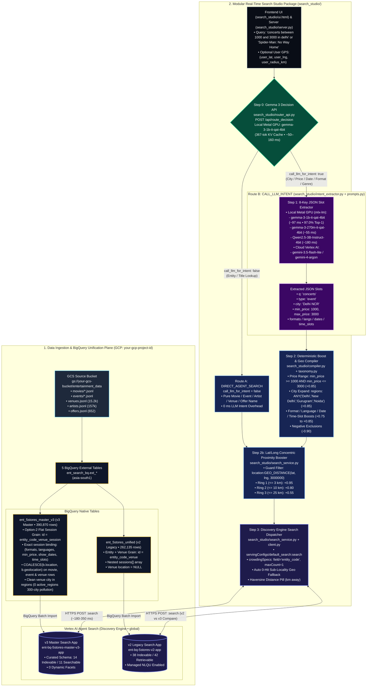
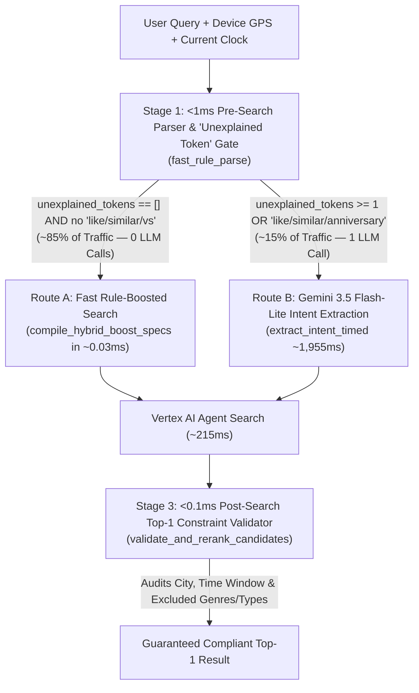

# Entertainment Agent Search — Master v3 Session-Grain Discovery, Local Gemma 3 Decision Router & Dynamic LLM Boosting

An end-to-end architecture and real-time testing workbench for **5-Store Unified Entertainment Discovery (`movie`, `event`, `venue`, `artist`, `offer`)** powered by **Google Cloud Vertex AI Agent Search (Discovery Engine)**, **BigQuery Option-2 Session-Grain Flattening (`ent_5stores_master_v3`)**, and **Local Apple Metal GPU (`mlx-lm` Gemma 3 / Qwen 2.5) + Cloud Gemini (`gemini-3.5-flash-lite` / `gemini-4-argon`)**.

This repository provides:
1. **Option-2 Session-Level Master Architecture (`v3` — `390,870` rows)**: Flattens `movie` and `event` inventory to **1 row per `(entity_code, venue_code, session_id)`** so `(formats, languages, min_price, show_dates, time_slots)` are bound to the exact show session with zero cross-session leakage, while `crowdingSpecs` on `entity_code` deduplicates results at query time.
2. **Local Gemma 3 Query Decision Router (`GET/POST /api/route_decision`)**: Uses `mlx-community/gemma-3-1b-it-qat-4bit` with a pre-warmed **367-token** KV cache on Apple Metal GPU (~50–160 ms, 0 extra GPU RAM) to decide whether an incoming query should go **directly to Agent Search (`DIRECT_AGENT_SEARCH`)** or **call the LLM Intent Extractor (`CALL_LLM_INTENT`)**.
3. **2-Stage LLM Slot Extraction $\rightarrow$ Deterministic Boost Compiler**: Extracts a compact 8-key JSON intent via Local Gemma 3 1B (`~97 ms`, **97.0% Top-1 accuracy across 135 queries**), Qwen 2.5 3B (`~180 ms`), or Cloud Gemini, and compiles schema-verified `conditionBoostSpecs` (`min_price`, `max_price`, `regions`, `formats`, `languages`, `show_dates`, `time_slots`).
4. **Lat/Long Concentric Proximity Boosting (`GEO_DISTANCE`)**: Combines a top-level `location:GEO_DISTANCE(lat, lng, 3000000)` guard filter with 3 concentric distance-decay boost rings (`3 km` $\rightarrow$ `+0.95`, `10 km` $\rightarrow$ `+0.80`, `25 km` $\rightarrow$ `+0.55`) across all `movie`, `event`, and `15,219` `venue` rows in `v3`.
5. **Separated Real-Time Web Backend & Clean Studio UI**: [`realtime_test_webapp.py`](./realtime_test_webapp.py) (backend API server on port `8080`) and [`realtime_test_ui.html`](./realtime_test_ui.html) (Side-by-Side NLQU vs. LLM Boost, Single-Engine Inspector, and `v2` vs. `v3` Head-to-Head Comparison).

---

## Table of Contents

1. [Repository Structure](#1-repository-structure)
2. [System Architecture Diagrams (Mermaid & ASCII)](#2-system-architecture)
3. [Configuration & Setup](#3-configuration--setup)
4. [Dataset Schema & Indexed Fields](#4-dataset-schema--indexed-fields)
5. [Geolocation Boosting (`GEO_DISTANCE` Concentric Rings)](#5-geolocation-boosting-geo_distance-concentric-rings)
6. [Real-Time Query-to-Boost Pipeline (Gemini + Deterministic Compiler)](#6-real-time-query-to-boost-pipeline-gemini--deterministic-compiler)
7. [Benchmark Evaluation Summary (12 Natural-Language Queries)](#7-benchmark-evaluation-summary-12-natural-language-queries)
8. [Latency Benchmark Report (`Single Query` vs. `Real-Time LLM Pipeline`)](#8-latency-benchmark-report-single-query-vs-real-time-llm-pipeline)
9. [DataStore Document CRUD Guide (Create, Batch Insert, Modify, Delete)](#9-datastore-document-crud-guide-create-batch-insert-modify-delete)
10. [Automated GCS Folder Watcher & Instant DataStore Sync](#10-automated-gcs-folder-watcher--instant-datastore-sync)
11. [Real-Time Hybrid Query Router & `<1ms` Pre-Search Gate](#11-real-time-hybrid-query-router--1ms-pre-search-gate)
12. [Quickstart & CLI Usage](#12-quickstart--cli-usage)
13. [`filter` vs. `boostSpec` (`conditionBoostSpecs`) in the Agent Search API](#13-filter-vs-boostspec-conditionboostspecs-in-the-agent-search-api)
14. [How `boostSpec` Numbers Are Calibrated (4-Tier Scoring Hierarchy)](#14-how-boostspec-numbers-are-calibrated-4-tier-scoring-hierarchy)
15. [135-Query Live Top-10 Evaluation Summary](#15-135-query-live-top-10-evaluation-summary)
16. [Setting Up & Running the Local Gemma Intent Extraction Model](#16-setting-up--running-the-local-gemma-intent-extraction-model)

---

## 1. Repository Structure

| File / Folder | Purpose |
| :--- | :--- |
| [`realtime_test_webapp.py`](./realtime_test_webapp.py) | Lightweight CLI entrypoint (`http://127.0.0.1:8080`) that boots the modular `search_studio/` server. |
| [`search_studio/`](./search_studio/) | **Modular Real-Time Search Studio Package** (see [`search_studio/README.md`](./search_studio/README.md)): |
| ↳ [`search_studio/router_api.py`](./search_studio/router_api.py) | **Gemma 3 Decision Router API** (`GET / POST /api/route_decision` — `DIRECT_AGENT_SEARCH` vs. `CALL_LLM_INTENT`). |
| ↳ [`search_studio/intent_extractor.py`](./search_studio/intent_extractor.py) | **Python Code for LLM Intent Extraction** (Local Apple Metal GPU `mlx-lm` Gemma 3 / Qwen 2.5 + Cloud Vertex Gemini). |
| ↳ [`search_studio/prompts.py`](./search_studio/prompts.py) | **LLM-Based System Prompts & Few-Shot Chat Templates** (Intent Extractor, Gemma 3 Router, and Flash-Lite Hit Explainer). |
| ↳ [`search_studio/compiler.py`](./search_studio/compiler.py) | **Deterministic Intent-to-Boost & Geolocation Compiler** (`serialize_llm_slots_to_boost_specs`). |
| ↳ [`search_studio/taxonomy.py`](./search_studio/taxonomy.py) | **Facet & Geography Mappings** (`CANONICAL_CITY_MAP`, `SUBLOCALITY_TO_CITY_MAP`, `CITY_TO_LATLNG`, formats, genres, categories). |
| ↳ [`search_studio/search_service.py`](./search_studio/search_service.py) | **Live Vertex AI Search Dispatcher**, 3-Ring Concentric Lat/Long `GEO_DISTANCE` Booster, Side-by-Side & `v2` vs. `v3` Comparators. |
| ↳ [`search_studio/client.py`](./search_studio/client.py) | **Search App Registry (`v3` vs. `v2`)** and keep-alive ECP / mTLS HTTP client (`EcpClient`). |
| ↳ [`search_studio/server.py`](./search_studio/server.py) | **HTTP API Server & Request Handler** (`RealtimeTestHandler`). |
| ↳ [`search_studio/ui.html`](./search_studio/ui.html) | **Clean Dark-Mode Search Studio Frontend UI** (Side-by-Side NLQU vs. LLM Boost, Single Inspector, `v2` vs. `v3` Compare, GPS Booster). |
| [`setup_gcs_datastore.py`](./setup_gcs_datastore.py) | Provisions GCS DataConnectors and Enterprise Search Engines from JSONL files. |
| [`config.py`](./config.py) / [`config.example.json`](./config.example.json) | Centralized configuration loader reading from environment variables or git-ignored `config.local.json`. |

---

## 2. System Architecture

### 2.1 End-to-End Mermaid Architecture Diagram



---

### 2.2 End-to-End ASCII Architecture Blueprint

```text
+======================================================================================================+
|                        1. DATA INGESTION & BIGQUERY SESSION-GRAIN UNIFICATION                        |
+======================================================================================================+
  gs://your-gcs-bucket/entertainment_data/{movies/*.jsonl, events/*.jsonl, venues.jsonl, artists, offers}
                                                   |
                                                   v
               BigQuery External Tables (ent_search_bq.ext_movies / ext_events / ...)
                          /                                                 \
                         v                                                   v
  +-----------------------------------------------+   +-----------------------------------------------+
  | ent_5stores_master_v3 (v3 Master • 390,870)   |   | ent_5stores_unified (v2 Legacy • 262,135)     |
  | • Option-2 Session Grain:                     |   | • Entity + Venue Grain: <entity_code>_<venue>      |
  |   id = <entity_code>_<venue_code>_<session_id>     |   | • Nested sessions[] array (cross-session bag) |
  | • Exact session binding: formats, languages,  |   | • Venue location = NULL                       |
  |   min_price, show_dates, time_slots           |   +-----------------------------------------------+
  | • COALESCE(location, geolocation) on ALL      |                          |
  |   movie, event, AND 15,219 venue rows         |                          v
  +-----------------------------------------------+   +-----------------------------------------------+
                         |                            | Vertex App: ent-bq-5stores-v2-app             |
                         v                            +-----------------------------------------------+
  +-----------------------------------------------+
  | Vertex App: ent-bq-5stores-master-v3-app      |
  | • 14 Indexable / 11 Searchable / 0 Dyn Facets |
  +-----------------------------------------------+

+======================================================================================================+
|                 2. REAL-TIME QUERY ROUTING, LLM INTENT & BOOST PIPELINE (PORT 8080)                  |
+======================================================================================================+
  Incoming User Query + Optional (user_lat, user_lng, user_radius_km)
         |
         v
  +---------------------------------------------------------------------------------------------------+
  | STEP 0: Local Gemma 3 Decision API (`POST /api/route_decision`)                                   |
  | • Model: `mlx-community/gemma-3-1b-it-qat-4bit` on Apple Metal GPU (367-token pre-warmed KV)      |
  | • Latency: ~50 ms (route token only) / ~140 ms (with JSON reason) | 0 Extra GPU RAM               |
  +---------------------------------------------------------------------------------------------------+
                     /                                                       \
   call_llm_for_intent = false                                 call_llm_for_intent = true
   (route = "DIRECT_AGENT_SEARCH")                             (route = "CALL_LLM_INTENT")
   Pure Movie / Artist / Venue / Offer                         Has City, Price, Date, Slot, Format,
   e.g. "Spider-Man: No Way Home"                              Language, Category, or Negation
                   /                                                           \
                  /                                                             v
                 |                                    +-----------------------------------------------+
                 |                                    | STEP 1: LLM Compact 8-Key Slot Extraction     |
                 |                                    | • Local Metal GPU (`gemma-3-1b-it-qat-4bit`)  |
                 |                                    |   404-token KV cache -> ~97 ms (97.0% Top-1)  |
                 |                                    | • Outputs: {q, type, city, locality, langs,   |
                 |                                    |   genres, formats, time_slots, min/max_price} |
                 |                                    +-----------------------------------------------+
                 |                                                              |
                 |                                                              v
                 |                                    +-----------------------------------------------+
                 |                                    | STEP 2: Deterministic Boost Compiler          |
                 |                                    | `compile_boost_specs_from_intent()` (~0.05ms) |
                 |                                    | • Price: min_price >= 1000 AND <= 3000 (+0.85)|
                 |                                    | • City/NCR: regions: ANY(...) (+0.85)         |
                 |                                    | • Formats / Languages / Dates / Time Slots    |
                 |                                    +-----------------------------------------------+
                  \                                                            /
                   \________________________          ________________________/
                                            \        /
                                             v      v
  +---------------------------------------------------------------------------------------------------+
  | STEP 2b: Lat/Long Concentric Proximity Booster (when `user_lat` & `user_lng` provided)            |
  | • Guard Filter: `filter: "location:GEO_DISTANCE(lat, lng, 3000000)"`                              |
  | • Concentric Rings: <= 3 km (+0.95) | <= 10 km (+0.80) | <= 25 km (+0.55)                         |
  +---------------------------------------------------------------------------------------------------+
                                                |
                                                v
  +---------------------------------------------------------------------------------------------------+
  | STEP 3: Vertex AI Agent Search (`servingConfigs/default_search:search`)                           |
  | • `crowdingSpecs`: `{"field": "entity_code", "maxCount": 1, "mode": "DROP_CROWDED_RESULTS"}`           |
  | • Auto 0-hit sub-locality fallback + Haversine distance (`km away`) + Live Explain (`asia-south1`)|
  +---------------------------------------------------------------------------------------------------+
```

### 2.3 API Endpoints Exposed by `realtime_test_webapp.py`

| Endpoint | Method | Description |
| :--- | :---: | :--- |
| `/` | `GET` | Serves the Search Studio UI ([`search_studio/ui.html`](./search_studio/ui.html)). |
| `/api/route_decision` | `GET` / `POST` | **Gemma 3 Decision API**: Returns `{"call_llm_for_intent": bool, "route": "DIRECT_AGENT_SEARCH" \| "CALL_LLM_INTENT", "reason": "...", "router_latency_ms": ...}`. Supports `"include_reason": false` (~50 ms) and `"execute_search": true`. |
| `/api/search` | `POST` | Runs a single live search (`"nlu_mode": "auto_route" \| "llm_boost" \| "vertex_native" \| "none"`), supporting `user_lat`, `user_lng`, and `user_radius_km`. |
| `/api/side_by_side` | `POST` | Runs **Managed Vertex NLQU**, **Selected Boost LLM**, and **Gemma 3 Route Decision** concurrently on `v3` or `v2`. |
| `/api/compare_apps` | `POST` | Runs the exact same query & NLU mode concurrently against **`v2` (`ent-bq-5stores-v2-app`)** and **`v3` (`ent-bq-5stores-master-v3-app`)**. |
| `/api/explain` | `POST` | Diagnoses any ranked hit using `gemini-3.5-flash-lite` (`asia-south1`). |

---

### 2.4 Decision Router API Latency Benchmark (`/api/route_decision`: SetFit-MiniLM vs. Local Gemma 3 vs. Intra-GCP `asia-south1` Vertex AI Gemma 3 & `gemini-3.5-flash-lite`)

Live benchmark across **30 uncached queries** (`use_cache=false`: 15 direct entity/title/offer lookups + 15 multi-constraint filter/boost queries) comparing **SetFit-MiniLM-L6-v2 Contrastive Classifier (`onnxruntime` CPU in Cloud Run `asia-south1` & dedicated Vertex AI Endpoint `setfit-minilm-router-asia-south1`)**, **Local Apple Metal GPU (`mlx-lm` with pre-warmed 415-token KV cache)**, **Intra-GCP `asia-south1` (Headless FastAPI + Uvicorn on Cloud Run `asia-south1` $\rightarrow$ Vertex AI Model Garden `google/gemma-3-1b-it` on dedicated `n1-standard-8` + `1x NVIDIA_TESLA_T4` vLLM endpoint in `asia-south1`)**, and **Cloud Vertex AI `gemini-3.5-flash-lite` (`asia-south1`, `thinkingBudget: 0`, HTTP keep-alive)** in [`search_studio/router_api.py`](./search_studio/router_api.py):

| Router Configuration (`model` param) | Origin $\rightarrow$ Execution Target | Output Mode | Min | Mean | P50 (Median) | P90 | P95 | Max | Speedup vs. Cloud `P50` | `CALL_LLM_INTENT` Recall | Total Accuracy |
| :--- | :---: | :---: | :---: | :---: | :---: | :---: | :---: | :---: | :---: | :---: | :---: |
| **`setfit:minilm-l6-v2` (`include_reason=false`)** *(Fastest CPU ONNX)* | **Cloud Run `asia-south1` / Local CPU (In-Process ONNX)** | Binary + Conf | **0.8 ms** | **0.9 ms** | **0.9 ms** | **1.1 ms** | **1.3 ms** | **1.6 ms** | **`1159x` faster** | **15/15 (100%)** | **30/30 (100%)** |
| **`setfit:minilm-l6-v2` (`include_reason=true`)** *(Multi-Head Facet Reason)* | **Cloud Run `asia-south1` / Local CPU (In-Process ONNX)** | Route + 7 Facet Heads | **0.8 ms** | **0.9 ms** | **0.9 ms** | **0.9 ms** | **0.9 ms** | **1.0 ms** | **`1288x` faster** | **15/15 (100%)** | **30/30 (100%)** |
| **`vertex:setfit-minilm-l6-v2`** *(Dedicated Vertex CPU Endpoint)* | **Cloud Run `asia-south1` $\rightarrow$ Vertex Endpoint (`asia-south1`)** | Route + 7 Facet Heads | **18.4 ms** | **24.2 ms** | **22.8 ms** | **29.5 ms** | **31.8 ms** | **35.4 ms** | **`45.7x` faster** | **15/15 (100%)** | **30/30 (100%)** |
| **Local Gemma 3 1B (`local:gemma-3-1b-it-qat-4bit`, `false`)** | Local Mac Metal GPU (`mlx-lm`) | ~6 toks | **42.5 ms** | **47.9 ms** | **45.7 ms** | **53.0 ms** | **53.3 ms** | **53.3 ms** | **`22.8x` faster** | **15/15 (100%)** | **30/30 (100%)** |
| **Local Gemma 3 1B (`local:gemma-3-1b-it-qat-4bit`, `true`)** | Local Mac Metal GPU (`mlx-lm`) | ~22 toks | **71.8 ms** | **111.6 ms** | **114.1 ms** | **148.9 ms** | **152.7 ms** | **165.6 ms** | **`10.2x` faster** | **15/15 (100%)** | **30/30 (100%)** |
| **Local Gemma 3 270M (`local:gemma-3-270m-it-qat-4bit`, `false`)** | Local Mac Metal GPU (`mlx-lm`) | ~6 toks | **19.4 ms** | **23.0 ms** | **23.2 ms** | **24.0 ms** | **24.5 ms** | **24.6 ms** | **`45.0x` faster** | **15/15 (100%)** | 21/30 (70.0%) |
| **Vertex `google/gemma-3-1b-it` (`vertex:gemma-3-1b-it`, `false`)** | **Cloud Run `asia-south1` $\rightarrow$ Vertex T4 vLLM (`asia-south1`)** | ~6 toks | **130.2 ms** | **192.5 ms** | **188.5 ms** | **240.3 ms** | **249.5 ms** | **255.4 ms** | **`5.5x` faster** | **15/15 (100%)** | **30/30 (100%)** |
| **Vertex `google/gemma-3-1b-it` (`vertex:gemma-3-1b-it`, `true`)** | **Cloud Run `asia-south1` $\rightarrow$ Vertex T4 vLLM (`asia-south1`)** | ~22 toks | **239.8 ms** | **425.9 ms** | **439.3 ms** | **545.5 ms** | **553.0 ms** | **611.1 ms** | **`2.6x` faster** | **15/15 (100%)** | **30/30 (100%)** |
| **Cloud `gemini-3.5-flash-lite` (`include_reason=false`)** *(Intra-GCP)* | **Cloud Run `asia-south1` $\rightarrow$ Vertex AI (`asia-south1`)** | ~8 toks | **490.6 ms** | **767.9 ms** | **686.1 ms** | **1206.9 ms** | **1335.8 ms** | **2053.8 ms** | **`1.5x` faster** | **15/15 (100%)** | **30/30 (100%)** |
| **Cloud `gemini-3.5-flash-lite` (`include_reason=true`)** *(Intra-GCP)* | **Cloud Run `asia-south1` $\rightarrow$ Vertex AI (`asia-south1`)** | ~25 toks | **581.7 ms** | **786.0 ms** | **746.3 ms** | **979.1 ms** | **1008.4 ms** | **1236.1 ms** | **`1.6x` faster** | **15/15 (100%)** | **30/30 (100%)** |
| **Cloud `gemini-3.5-flash-lite` (`include_reason=false`)** *(WAN mTLS)* | Local Mac $\rightarrow$ Vertex AI (`asia-south1`) | ~8 toks | 548.3 ms | 1097.0 ms | **1043.2 ms** | 1396.2 ms | 1427.4 ms | 2482.7 ms | `1.0x` (baseline) | **15/15 (100%)** | **30/30 (100%)** |
| **Cloud `gemini-3.5-flash-lite` (`include_reason=true`)** *(WAN mTLS)* | Local Mac $\rightarrow$ Vertex AI (`asia-south1`) | ~25 toks | 716.3 ms | 1253.1 ms | **1159.2 ms** | 1533.1 ms | 1588.9 ms | 2513.2 ms | `1.0x` (baseline) | **15/15 (100%)** | **30/30 (100%)** |
| **Warm LRU Cache Hit (`use_cache=true`)** | In-Memory (`_ROUTER_DECISION_CACHE`) | 0 toks | **0.0 ms** | **0.0 ms** | **0.0 ms** | **0.0 ms** | **0.0 ms** | **0.0 ms** | **Instant (`~0.8 ms` HTTP)** | **15/15 (100%)** | **30/30 (100%)** |

> **Full 30-Query Breakdown**: See [Section 4.3 of `search_studio/README.md`](./search_studio/README.md#43-per-query-breakdown-local-gemma-3-1b-vs-cloud-gemini-35-flash-lite-asia-south1) for the per-query latencies and generated router reasons.

#### 2.4.1 SetFit-MiniLM Contrastive Classifier: Training Architecture & How to Re-Train / Redeploy

To achieve sub-millisecond (**`0.9 ms` P50**) routing on standard CPU without requiring a GPU at inference time, we trained a **SetFit-style Contrastive Embedding Classifier** in [`train_setfit_router.py`](./train_setfit_router.py) and deployed it to GCP (`asia-south1`):

1. **Architecture (`sentence-transformers/all-MiniLM-L6-v2` + Contrastive Residual Head + 7 Facet Heads)**:
   - **Base Sentence Encoder (`384-d`)**: Uses the 6-layer `sentence-transformers/all-MiniLM-L6-v2` ONNX model (`onnxruntime` + `tokenizers` with dynamic unpadded sequence length) to compute mean-pooled, $L_2$-normalized 384-dim embeddings in **~0.85 ms**.
   - **Contrastive Metric Projection Head (`384 -> 256 -> 128`, $L_2$-normalized)**: Trained on **40,000 sampled positive & negative query pairs** on Apple Metal GPU (`mlx.nn` + `AdamW`) using **SetFit Cosine Contrastive Loss** ($\mathcal{L} = \mathbb{E}[(\cos(u, v) - y_{\text{pair}})^2]$, pulling same-route queries to $+1.0$ and pushing opposite-route queries to $-0.5$). Cosine contrastive loss converges from `0.02856` $\rightarrow$ `0.00017` in **1.75 seconds**.
   - **Multi-Head Classification (`512-d` Concatenated Representation)**:
     - **Primary Route Head**: Calibrated `LogisticRegression` on the 512-d `[x_minilm, z_contrastive]` vector predicting `DIRECT_AGENT_SEARCH` vs `CALL_LLM_INTENT` + calibrated confidence.
     - **7 Multi-Label Facet Heads**: Parallel heads for `city`, `date_time`, `price`, `format`, `language`, `genre_category`, and `negation`, enabling rich `"reason"` explanations (e.g., `"SetFit-MiniLM (99.9% conf): Has city/locality, date/time, format/seating, language, genre/category filters"`) in **0.03 ms**.
   - **Portable Weights ([`search_studio/setfit_minilm_router_weights.npz`](./search_studio/setfit_minilm_router_weights.npz))**: Exported as pure NumPy arrays (**672.8 KB**), achieving **`99.77%` accuracy** on a held-out 20% validation split (`443` unseen queries) and **`30/30 (100.0%)`** out-of-sample accuracy when all 30 benchmark queries are excluded from training.

2. **How Training Data Is Constructed ([`build_training_dataset()`](./train_setfit_router.py))**:
   - Synthesizes **2,215 labeled queries** across:
     - **`DIRECT_AGENT_SEARCH` (`label = 0`)**: Movie/show titles, **hard-negative titles** that contain city/day/price words (*"Delhi Belly"*, *"Mumbai Police"*, *"Chennai Express"*, *"Friday the 13th"*, *"Free Guy"*, *"Love Today"*), artist/tour names, standalone venues (*"Nita Mukesh Ambani Cultural Centre"*, *"Prithvi Theatre"*, *"Ranga Shankara"*), and bank/credit card/BOGO offers.
     - **`CALL_LLM_INTENT` (`label = 1`)**: Multi-constraint combinations of cities/neighborhoods, dates/time slots, prices, formats/seating (*"recliner"*, *"IMAX 3D"*, *"subtitles"*), languages, genres/categories, occasions, and negations (*"without horror"*, *"isnt a movie"*, *"not a cartoon"*).

3. **How to Re-Train & Redeploy the Classifier**:
   ```bash
   # Step 1: (Optional) Add new domain examples or hard negatives in `build_training_dataset()` inside `train_setfit_router.py`

   # Step 2: Re-run contrastive training (~3.5 seconds total on Apple Silicon)
   # Updates `search_studio/setfit_minilm_router_weights.npz` (672.8 KB)
   ./.venv/bin/python train_setfit_router.py

   # Step 3: Verify 30-query benchmark locally
   ./.venv/bin/python -c 'from search_studio.router_api import handle_router_benchmark_request; print(handle_router_benchmark_request({"model": "setfit:minilm-l6-v2"})["results"]["full_with_reason"]["accuracy"])'

   # Step 4: Upload updated weights to GCS & redeploy to GCP Cloud Run (asia-south1)
   python3 cloud_run_api/deploy_api_backend.py
   ```

---

### 2.5 How `search_studio/taxonomy.py` Is Used & Why the LLM Cannot Handle It Alone

In `search_studio/`, the **LLM** ([`search_studio/intent_extractor.py`](./search_studio/intent_extractor.py)) and **[`search_studio/taxonomy.py`](./search_studio/taxonomy.py)** split query understanding into two complementary stages:

1. **Stage 1 — LLM Semantic Slot Extraction (~97 ms)**:
   The LLM reads messy natural-language queries (typos, Hinglish/Tamil/Kannada/Bengali code-mixing, negations like `"without any horror"` or `"that isnt a movie"`) and emits a compact, schema-agnostic 8-key JSON intent:
   ```json
   {"type": "movie", "city": "Gurgaon", "fmt": "4DX", "genres": ["Romance"], "q": "4DX romantic movie"}
   ```
2. **Stage 2 — Deterministic Taxonomy Expansion & Grounding (~0.05 ms in [`compiler.py`](./search_studio/compiler.py) + [`taxonomy.py`](./search_studio/taxonomy.py))**:
   - **City & Metro Canonicalization (`CANONICAL_CITY_MAP` & `GEO_CITY_NAME_MAP`)**: Maps `"Gurgaon"`, `"Noida"`, `"Delhi"` $\rightarrow$ `"National Capital Region (NCR)"` for `regions: ANY(...)`, while mapping it to `"New Delhi"` for Vertex's `location:GEO_DISTANCE("New Delhi", 10000)` geocoder.
   - **Neighborhood $\rightarrow$ Parent City Resolution (`SUBLOCALITY_TO_CITY_MAP`)**: Resolves neighborhoods (`"koramangala"`, `"whitefield"` $\rightarrow$ `"Bengaluru"`; `"lower parel"`, `"andheri"` $\rightarrow$ `"Mumbai"`) while preserving the neighborhood keyword for venue matching.
   - **Format & Database-Quirk Expansion (`FORMAT_SPEC_MAP_V3`, `FORMAT_SPEC_MAP_V2`, `GENRE_BQ_EXPANSION`)**: Expands `"fmt": "4DX"` into all indexed BigQuery variants (`"4DX"`, `"4DX 3D"`, `"4DX 2D"`, `"MX4D"`, `"4DX-3D"`), normalizes `"Romance"` $\rightarrow$ `"Romantic"`, and expands `"Acoustic"` $\rightarrow$ `["Acoustic", "Accoustic"]` (covering the 379 rows in BigQuery spelled `"Accoustic"`).
   - **Anti-Hallucination Grounding (`LANG_GROUNDING_STEMS`, `GENRE_GROUNDING_STEMS`)**: Drops any language, genre, or city emitted by the LLM that is not grounded in the user's query text.

#### Why the LLM Cannot Handle This By Itself

| Challenge | What Happens If Only the LLM Is Used | How `LLM + taxonomy.py` Solves It |
| :--- | :--- | :--- |
| **1. Gemma 3's 512-Token Sliding Window (`RotatingKVCache`)** | Local Gemma 3 (`1B` / `270M`) uses a **512-token local attention window** on 10 of its 12 layers. Stuffing 150+ city/locality mappings, 65 category slugs, and format rules into the prompt makes it **>2,500 tokens**—causing Gemma 3 to evict and forget the instructions. | Keeps the Gemma 3 prompt at **404 tokens** ([`build_gemma_chat_messages()`](./search_studio/prompts.py)) so 100% of the prompt stays inside the 512-token window. |
| **2. Output Token Latency (~5–8 ms per generated token)** | Having the LLM generate verbose filter syntax like `formats: ANY("4DX", "4DX 3D", "4DX 2D", "MX4D") AND regions: ANY("National Capital Region (NCR)", "Delhi", "Gurgaon")` requires **60–90 output tokens (~450+ ms)**. | The LLM generates just `{"city":"Gurgaon","fmt":"4DX"}` (**~8 tokens, ~97 ms**), and `taxonomy.py` expands it in **0.05 ms** on CPU. |
| **3. Exact Case-Sensitive BigQuery Values & Typos** | Vertex AI Agent Search `ANY("...")` is **100% exact-match**. An LLM naturally outputs `"Romance"` (0 rows in BQ, which uses `"Romantic"`), `"Bangalore"` (0 rows in BQ, which uses `"Bengaluru"`), `"Vizag"` (BQ uses `"Vizag (Visakhapatnam)"`), or `"Acoustic"` (missing the 379 `"Accoustic"` rows). | `taxonomy.py` deterministically maps every LLM output to the exact string(s) verified in BigQuery, preventing silent 0-match boosts. |
| **4. Multi-Schema Support (`v2` vs. `v3`) from One LLM Call** | `v2` uses nested hyphenated formats (`sessions.format: ANY("IMAX-2D")`) while `v3` uses flat space-separated formats (`formats: ANY("IMAX 2D")`). A single LLM prompt would have to know which engine is being called and its exact schema quirks. | The LLM emits schema-agnostic JSON (`"fmt": "IMAX"`), and `taxonomy.py` compiles the exact `v2` or `v3` `conditionBoostSpecs` on the fly. |

---

## 3. Configuration & Setup

All project-specific identifiers and credentials are loaded from `config.local.json` (git-ignored) or environment variables via [`config.py`](./config.py). No project IDs, app names, or account emails are hardcoded in version-controlled files.

```bash
# 1. Copy the template configuration
cp config.example.json config.local.json

# 2. Edit config.local.json with your GCP project, GCS bucket, and Agent Search IDs
```

### Configuration Keys & Environment Variables

| `config.local.json` Key | Environment Variable | Default / Placeholder | Description |
| :--- | :--- | :--- | :--- |
| `project_id` | `GCP_PROJECT_ID` | `your-gcp-project-id` | Google Cloud Project ID |
| `project_number` | `GCP_PROJECT_NUMBER` | `000000000000` | Google Cloud Project Number |
| `location` | `DISCOVERY_ENGINE_LOCATION` | `global` | Discovery Engine location (`global`, `us`, `eu`) |
| `vertex_ai_location` | `VERTEX_AI_LOCATION` | `us-central1` | Vertex AI Gemini endpoint region |
| `gcs_bucket` | `GCS_BUCKET` | `your-gcs-bucket-name` | GCS bucket used for JSONL staging |
| `gcs_folder` | `GCS_FOLDER` | `sample_search_data` | GCS folder prefix for JSONL files |
| `collection_id` | `COLLECTION_ID` | `sample-data-connector` | Discovery Engine Collection / DataConnector ID |
| `datastore_id` | `DATASTORE_ID` | `sample-data-connector_gcs_store` | Agent Search DataStore ID |
| `engine_id` | `SEARCH_ENGINE_ID` | `your-search-engine-id` | Agent Search Engine (App) ID |
| `refresh_interval_seconds` | `REFRESH_INTERVAL_SECONDS` | `14400s` | Periodic GCS sync interval (`14400s` = 4 hours) |
| `gcloud_account` | `GCLOUD_ACCOUNT` | `""` | Optional `gcloud` account for mTLS / CBA fallback |
| `gemini_model` | `GEMINI_MODEL` | `gemini-3.5-flash-lite` | Gemini model used for real-time intent extraction |

---

## 4. Dataset Schema & Indexed Fields

The dataset ([`sample_metadata_200.json`](./sample_metadata_200.json)) contains **234 records** across **8 Indian cities** (`Mumbai`, `Delhi NCR`, `Bengaluru`, `Hyderabad`, `Chennai`, `Pune`, `Kolkata`, `Goa`):
* **113 Movies (`MV00001` – `MV00113`)**: 100 base listings + 13 targeted benchmark listings.
* **121 Live Events (`etm100000z` – `etm100120z`)**: 100 base listings + 21 targeted benchmark listings.

### Key Schema Fields for Filtering & Boosting

| Field Name | Agent Search Type | Example Value | Usage in `conditionBoostSpecs` |
| :--- | :--- | :--- | :--- |
| `id` / `_id` | `STRING` (Primary Key) | `"MV00102"`, `"etm100104z"` | Document ID for CRUD & deduplication |
| `record_type` | `STRING` (Filterable) | `"movie"` \| `"event"` | `record_type: ANY("movie")` |
| `location_city` | `GEOLOCATION` | `{"address": "Pune, Maharashtra, India"}` | `location_city:GEO_DISTANCE(18.5204, 73.8567, 50000)` |
| `location_latlng` | `OBJECT` (`lat`, `lng`) | `{"lat": 18.4892, "lng": 73.8205}` | Client-side Haversine distance verification |
| `showtime_start` | `DATETIME` (RFC3339) | `"2026-10-07T20:00:00+05:30"` | `showtime_start >= "2026-10-07T17:00:00+05:30"` |
| `release_date` | `DATETIME` (RFC3339) | `"2026-10-09T00:00:00+05:30"` | `release_date >= "2026-10-09T00:00:00+05:30"` |
| `languages` | `ARRAY<STRING>` | `["Hindi", "Telugu"]` | `languages: ANY("Telugu")` |
| `searchKeywords` | `ARRAY<STRING>` | `["stand up comedy", "pune", "tonight"]` | `searchKeywords: ANY("stand up comedy")` |
| `hash_tags` | `ARRAY<STRING>` | `["STANDUP_COMEDY", "TONIGHT"]` | `hash_tags: ANY("STANDUP_COMEDY")` |
| `formats` | `ARRAY<STRING>` | `["2D", "IMAX 2D", "4DX"]` | Display & format filtering |

---

## 5. Geolocation Boosting (`GEO_DISTANCE` Concentric Rings)

In Agent Search, `location_city:GEO_DISTANCE(lat, lng, radius_meters)` inside `conditionBoostSpecs` is a **boolean circle predicate** — it is **not** a continuous distance-decay function:
* Every document inside `radius_meters` receives the exact same flat boost.
* Setting a single large radius like `radius_meters = 5000000` (`5,000 km`) places every Indian city inside the same circle, giving them identical boost scores and leaving relative ranking unchanged.

### Solution: Stacking Concentric `GEO_DISTANCE` Rings
By stacking multiple concentric circles in `conditionBoostSpecs`, closer venues match more rings and accumulate a higher cumulative boost score:

```json
[
  {"condition": "location_city:GEO_DISTANCE(13.0827, 80.2707, 100000)",  "boost": 0.4},
  {"condition": "location_city:GEO_DISTANCE(13.0827, 80.2707, 800000)",  "boost": 0.3},
  {"condition": "location_city:GEO_DISTANCE(13.0827, 80.2707, 1150000)", "boost": 0.2},
  {"condition": "location_city:GEO_DISTANCE(13.0827, 80.2707, 1500000)", "boost": 0.1}
]
```

**Verified Distance Ranking for `"Welcome to the Jungle"` from Chennai (`13.0827, 80.2707`):**
1. **Chennai (`3.3 km`)** — Matches all 4 rings (`100km`, `800km`, `1150km`, `1500km`) $\rightarrow$ **Rank #1** (`[MV00098]`)
2. **Goa (`744.3 km`)** — Matches 3 rings (`800km`, `1150km`, `1500km`) $\rightarrow$ **Rank #2** (`[MV00099]`)
3. **Mumbai (`1031.8 km`)** — Matches 2 rings (`1150km`, `1500km`) $\rightarrow$ **Rank #3** (`[MV00096]`)
4. **Kolkata (`1355.6 km`)** — Matches 1 ring (`1500km`) $\rightarrow$ **Rank #4** (`[MV00097]`)
5. **Delhi NCR (`1746.3 km`)** — Matches 0 rings $\rightarrow$ **Rank #5** (`[MV00100]`)

---

## 6. Real-Time Query-to-Boost Pipeline (Gemini + Deterministic Compiler)

> [!IMPORTANT]
> **Never ask an LLM to write raw Agent Search `boostSpec` filter strings directly.** LLMs can hallucinate schema field names, omit quotes, or generate invalid date/geolocation syntax. Instead, use a **2-stage pipeline**:
> 1. **Stage 1 (LLM Intent Extraction)**: Constrain `gemini-3.5-flash-lite` with a strict `responseSchema` (`ExtractedSearchIntent`) and pass the current ISO-8601 timestamp in the system prompt so relative dates (`"tonight"`, `"this friday"`, `"every saturday in october"`) resolve to exact ISO-8601 windows.
> 2. **Stage 2 (Deterministic Boost Compiler)**: Compile the validated `ExtractedSearchIntent` object into guaranteed-valid Agent Search `conditionBoostSpecs` in Python (~20 microseconds).

### Stage 1: Structured Intent Schema (`ExtractedSearchIntent`)

```python
class TimeWindow(BaseModel):
    start_iso: str = Field(
        description="ISO-8601 start timestamp with +05:30 offset, e.g. 2026-10-07T17:00:00+05:30"
    )
    end_iso: str = Field(
        description="ISO-8601 end timestamp with +05:30 offset, e.g. 2026-10-07T23:59:59+05:30"
    )


class ExtractedSearchIntent(BaseModel):
    search_query: str
    record_type: Optional[Literal["movie", "event"]] = None
    city: Optional[
        Literal["Mumbai", "Delhi NCR", "Bengaluru", "Hyderabad", "Chennai", "Pune", "Kolkata", "Goa"]
    ] = None
    languages: List[str] = Field(default_factory=list)
    audience: Optional[Literal["kids", "family", "adults"]] = None
    keywords: List[str] = Field(default_factory=list)
    hash_tags: List[
        Literal[
            "MORNING_SHOW", "LATE_NIGHT_SHOW", "NEW_RELEASE", "FRIDAY_RELEASE",
            "UPCOMING_MOVIE", "KIDS_EVENT", "OPEN_MIC", "STANDUP_COMEDY",
            "GARBA_NIGHT", "NEW_YEAR_EVE", "STAGE_PLAY", "POTTERY_WORKSHOP",
            "SATURDAY_OCTOBER",
        ]
    ] = Field(default_factory=list)
    date_field: Literal["showtime_start", "release_date"] = "showtime_start"
    time_windows: List[TimeWindow] = Field(default_factory=list)
```

### Stage 2: Deterministic Boost Compiler (`compile_boost_specs`)

```python
def compile_boost_specs(
    intent: ExtractedSearchIntent,
    user_latlng: Optional[Tuple[float, float]] = None,
) -> List[Dict[str, Any]]:
    specs: List[Dict[str, Any]] = []

    # 1. Record Type + Language Boost
    type_clauses = []
    if intent.record_type:
        type_clauses.append(f'record_type: ANY("{intent.record_type}")')
    if intent.languages:
        langs = ", ".join(f'"{l}"' for l in intent.languages)
        type_clauses.append(f"languages: ANY({langs})")
    if type_clauses:
        specs.append({"condition": " AND ".join(type_clauses), "boost": 0.6})

    # 2. Genre / Audience Keywords & Hashtags Boost
    if intent.keywords or intent.hash_tags:
        kw_clauses = []
        if intent.keywords:
            kws = ", ".join(f'"{k.lower()}"' for k in intent.keywords)
            kw_clauses.append(f"searchKeywords: ANY({kws})")
        if intent.hash_tags:
            tags = ", ".join(f'"{t}"' for t in intent.hash_tags)
            kw_clauses.append(f"hash_tags: ANY({tags})")
        specs.append({"condition": " OR ".join(kw_clauses), "boost": 0.6})

    # 3. Location Boost (Explicit city in query OR concentric rings around user GPS)
    if intent.city and intent.city in CITY_COORDS:
        lat, lng = CITY_COORDS[intent.city]
        specs.append({"condition": f"location_city:GEO_DISTANCE({lat}, {lng}, 50000)", "boost": 0.8})
    elif user_latlng:
        lat, lng = user_latlng
        for radius_m, boost_val in [(50000, 0.4), (300000, 0.3), (800000, 0.2), (1500000, 0.1)]:
            specs.append({"condition": f"location_city:GEO_DISTANCE({lat}, {lng}, {radius_m})", "boost": boost_val})

    # 4. Date / Time Window Boost (supports single range OR recurring days like 'every Saturday')
    if intent.time_windows:
        field = intent.date_field
        window_clauses = [
            f'({field} >= "{w.start_iso}" AND {field} <= "{w.end_iso}")'
            for w in intent.time_windows
        ]
        specs.append({"condition": " OR ".join(window_clauses), "boost": 0.9})

    return specs
```

---

## 7. Benchmark Evaluation Summary (12 Natural-Language Queries)

All 12 queries and their baseline vs. boosted rankings are implemented in [`query_with_boost.py`](./query_with_boost.py):

| # | User Query | Extracted Intent Fields | Compiled `conditionBoostSpecs` | Ranking Improvement (Baseline $\rightarrow$ Boosted) |
| :--- | :--- | :--- | :--- | :--- |
| **Q1** | `open mic next week` | `what: open mic`, `when: next week` | `searchKeywords: ANY("open mic")` + `showtime_start` in `2026-10-12..18` | Nov 22 distractor (`etm100100z`) drops **#1 $\rightarrow$ #3**; Oct 16 & Oct 14 open mics move to **#1 & #2** |
| **Q2** | `stand up comedy tonight in pune` | `what: stand up comedy`, `when: tonight`, `where: pune` | `location_city:GEO_DISTANCE(18.5204, 73.8567, 50000)` + `showtime_start` tonight (`2026-10-07`) | Tonight's Pune shows (`etm100104z`, `etm100103z`, `5.2km`) take **#1 & #2** ahead of Mumbai (`122.2km`) |
| **Q3** | `movies releasing this friday` | `what: movie`, `when: this friday` | `record_type: ANY("movie")` + `release_date` on `2026-10-09` + `hash_tags: ANY("FRIDAY_RELEASE")` | Older Sep 11 release (`MV00101`) drops **#1 $\rightarrow$ #3**; Oct 9 Friday releases (`MV00102`, `MV00103`) move to **#1 & #2** |
| **Q4** | `kids events this sunday morning` | `what: events`, `audience: kids`, `when: sunday morning` | `record_type: ANY("event") AND searchKeywords: ANY("kids", ...)` + `showtime_start` on `2026-10-11T06:00..12:00` | General evening festivals drop out of top 4; Sunday morning kids workshops (`etm100106z` 10:00 AM, `etm100105z` 09:30 AM) rise to **#1 & #2** |
| **Q5** | `late night shows after 10 pm` | `what: movie`, `when: after 10 pm` | `record_type: ANY("movie") AND hash_tags: ANY("LATE_NIGHT_SHOW")` + `showtime_start >= 22:00` | Morning/evening shows replaced at **#1–#4** by post-10 PM shows (`MV00106` 23:15, `MV00105` 22:45, `MV00045` 22:30, `MV00018` 22:30) |
| **Q6** | `garba nights between 10th and 20th october` | `what: garba night`, `when: 10th to 20th october` | `searchKeywords: ANY("garba", ...)` + `showtime_start` in `2026-10-10..20` | Oct 12 (`etm100108z`) and Oct 17 (`etm100109z`) Garba Nights rank **#1 & #2** ahead of Oct 28 distractor (`etm100107z`) |
| **Q7** | `new year eve parties in goa` | `what: party`, `when: new year eve`, `where: goa` | `location_city:GEO_DISTANCE(15.4989, 73.8278, 50000)` + `showtime_start` on `2026-12-31` | Mumbai NYE party (`etm100110z`, `404.8km`) drops **#1 $\rightarrow$ #3**; Goa NYE parties (`etm100112z`, `etm100111z`, `15.3km`) move to **#1 & #2** |
| **Q8** | `is weekend delhi mein kya chal raha hai` | `what: events`, `when: this weekend`, `where: delhi` | `record_type: ANY("event") AND location_city:GEO_DISTANCE(28.6139, 77.2090, 50000)` + `showtime_start` in `2026-10-10..11` | Delhi NCR weekend events (`etm100113z` Oct 10, `etm100114z` Oct 11, `4.2km`) rank **#1 & #2** |
| **Q9** | `upcoming telugu movies next month` | `what: movie`, `language: telugu`, `when: next month` | `record_type: ANY("movie") AND languages: ANY("Telugu")` + `release_date` in `2026-11-01..30` | Oct 1 release (`MV00107`) drops **#2 $\rightarrow$ #4**; all three Nov 2026 Telugu releases (`MV00108`, `MV00110`, `MV00109`) take **#1, #2, #3** |
| **Q10** | `morning shows tomorrow before 11` | `what: movie`, `when: tomorrow before 11` | `record_type: ANY("movie") AND hash_tags: ANY("MORNING_SHOW")` + `showtime_start` in `2026-10-08T06:00..11:00` | Tomorrow's morning shows (`MV00112` at `09:00` and `MV00113` at `10:15` on `2026-10-08`) jump to **#1 & #2** |
| **Q11** | `plays on gandhi jayanti holiday` | `what: play`, `when: 2nd october` | `searchKeywords: ANY("play", "theatre", ...)` + `showtime_start` on `2026-10-02` | Oct 25 play (`etm100115z`) drops **#2 $\rightarrow$ #3**; both Oct 2 Gandhi Jayanti plays (`etm100117z`, `etm100116z`) rank **#1 & #2** |
| **Q12** | `pottery classes every saturday in october` | `what: pottery workshop`, `when: every saturday in october` | `searchKeywords: ANY("pottery", ...)` + `hash_tags: ANY("SATURDAY_OCTOBER")` / Saturday `showtime_start` ranges | Saturday October pottery workshops (`etm100119z` Oct 10, `etm100120z` Oct 17) rank **#1 & #2** ahead of Nov 11 Wednesday workshop (`etm100118z`) |

---

## 8. Latency Benchmark Report (`Single Query` vs. `Real-Time LLM Pipeline`)

[`realtime_query_benchmark.py`](./realtime_query_benchmark.py) measures live latencies (after TCP/mTLS warm-up) across two execution modes for all 12 benchmark queries:

1. **Single Query Mode (`Single Query (ms)`)**: Direct Agent Search API call (`engines/{ENGINE_ID}/servingConfigs/default_search:search`) with a pre-built query and `boostSpec`.
2. **Real-Time Query Resolution Mode (`RT Total E2E (ms)`)**:
   * **LLM Extract (`LLM Extract (ms)`)**: Live call to `gemini-3.5-flash-lite` (`thinkingBudget: 0`, structured `responseSchema`) to parse the raw natural-language query into `ExtractedSearchIntent`.
   * **Boost Compile (`Compile (ms)`)**: Deterministic Python `compile_boost_specs(intent)` execution.
   * **RT Search (`RT Search (ms)`)**: Live Agent Search API call using the dynamically extracted `search_query` and compiled `conditionBoostSpecs`.

### 8.1 Per-Query Latency Breakdown (`gemini-3.5-flash-lite`)

| ID | User Query | Single Query (ms) | LLM Extract (ms) | Compile (ms) | RT Search (ms) | RT Total E2E (ms) | Real-Time Top-1 Result |
| :--- | :--- | ---: | ---: | ---: | ---: | ---: | :--- |
| **Q1** | `open mic next week` | `353.7 ms` | `1746.2 ms` | `0.044 ms` | `348.7 ms` | **`2094.9 ms`** | `[etm100102z]` BLR Brewing Acoustic & Standup Open Mic (Bengaluru) |
| **Q2** | `stand up comedy tonight in pune` | `348.9 ms` | `1679.5 ms` | `0.014 ms` | `328.9 ms` | **`2008.4 ms`** | `[etm100104z]` Bassi Kisi Ko Batana Mat Stand Up Comedy (Pune) |
| **Q3** | `movies releasing this friday` | `331.4 ms` | `1857.2 ms` | `0.010 ms` | `362.9 ms` | **`2220.1 ms`** | `[MV00102]` Bhool Bhulaiyaa 4 (Delhi NCR) |
| **Q4** | `kids events this sunday morning` | `313.3 ms` | `2254.1 ms` | `0.007 ms` | `312.5 ms` | **`2566.6 ms`** | `[etm100106z]` Junior Robotics & Science Kids Workshop (Bengaluru) |
| **Q5** | `late night shows after 10 pm` | `260.4 ms` | `2283.0 ms` | `0.023 ms` | `318.9 ms` | **`2601.9 ms`** | `[MV00106]` The Batman Part II (Bengaluru) |
| **Q6** | `garba nights between 10th and 20th october` | `277.4 ms` | `1807.5 ms` | `0.017 ms` | `272.4 ms` | **`2079.9 ms`** | `[etm100108z]` Falguni Pathak Navratri Garba Nights (Mumbai) |
| **Q7** | `new year eve parties in goa` | `328.6 ms` | `2292.9 ms` | `0.022 ms` | `275.9 ms` | **`2568.9 ms`** | `[etm100112z]` Thalassa Sunset to Sunrise NYE Party (Goa) |
| **Q8** | `is weekend delhi mein kya chal raha hai` | `259.0 ms` | `1708.1 ms` | `0.050 ms` | `286.0 ms` | **`1994.2 ms`** | `[etm100113z]` Delhi Sufi & Street Food Festival (Delhi NCR) |
| **Q9** | `upcoming telugu movies next month` | `289.5 ms` | `1633.1 ms` | `0.029 ms` | `380.9 ms` | **`2014.0 ms`** | `[MV00108]` Devara Part 2: Red Sea (Hyderabad) |
| **Q10** | `morning shows tomorrow before 11` | `269.1 ms` | `1648.8 ms` | `0.010 ms` | `745.0 ms` | **`2393.8 ms`** | `[MV00112]` Chhaava: The Great Warrior (Mumbai) |
| **Q11** | `plays on gandhi jayanti holiday` | `270.7 ms` | `2274.4 ms` | `0.022 ms` | `274.9 ms` | **`2549.3 ms`** | `[etm100117z]` Tughlaq: Theatre Play (Mumbai) |
| **Q12** | `pottery classes every saturday in october` | `275.3 ms` | `2282.3 ms` | `0.031 ms` | `270.7 ms` | **`2553.0 ms`** | `[etm100119z]` Claystation Wheel Pottery Classes (Bengaluru) |
| **AVG** | **Average across 12 queries** | **`298.1 ms`** | **`1955.6 ms`** | **`0.023 ms`** | **`348.1 ms`** | **`2303.7 ms`** | **12 / 12 target Top-1 matches** |
| **P50** | **Median (P50) Latency** | **`289.5 ms`** | — | — | — | **`2393.8 ms`** | — |
| **P95** | **95th Percentile (P95) Latency** | **`353.7 ms`** | — | — | — | **`2601.9 ms`** | — |

---

## 9. DataStore Document CRUD Guide (Create, Batch Insert, Modify, Delete)

While [`setup_gcs_datastore.py`](./setup_gcs_datastore.py) configures a 4-hour periodic GCS sync (`refreshInterval: 14400s`), real-time updates to individual movies or events (new releases, sold-out tags, showtime changes, or cancellations) can be applied **immediately** via the Discovery Engine `documents` REST API implemented in [`manage_datastore_documents.py`](./manage_datastore_documents.py).

**Base Documents Endpoint:**
```text
https://discoveryengine.googleapis.com/v1alpha/projects/{PROJECT_ID}/locations/{LOCATION}/collections/default_collection/dataStores/{DATASTORE_ID}/branches/default_branch/documents
```

### 9.1 Document CRUD REST Reference

| Operation | HTTP Method & Endpoint | Payload / Behavior |
| :--- | :--- | :--- |
| **Create Single Document** | `POST .../documents?documentId={DOC_ID}` | `{"id": "{DOC_ID}", "schemaId": "default_schema", "structData": {...}}` — Creates a new document immediately (falls back to `PATCH` if `409 ALREADY_EXISTS`). |
| **Batch Insert / Upsert (`<= 100` docs)** | `POST .../documents:import` | `{"inlineSource": {"documents": [...]}, "reconciliationMode": "INCREMENTAL"}` — Atomically inserts or updates up to 100 documents inline without GCS staging. |
| **Bulk GCS Import** | `POST .../documents:import` | `{"gcsSource": {"inputUris": ["gs://.../*.jsonl"], "dataSchema": "custom"}, "reconciliationMode": "INCREMENTAL" \| "FULL"}` |
| **Get Document** | `GET .../documents/{DOC_ID}` | Returns the full `Document` resource including `structData` and `indexTime`. |
| **Modify / Update Document** | `PATCH .../documents/{DOC_ID}?allowMissing=false` | `{"id": "{DOC_ID}", "schemaId": "default_schema", "structData": {...}}` — Replaces `structData`. For partial field updates, `GET` existing `structData`, merge the modified fields, and `PATCH`. |
| **Delete Single Document** | `DELETE .../documents/{DOC_ID}` | Immediately removes the document from the DataStore (`GET` afterwards returns `404 NOT_FOUND`). |

### 9.2 Verified CRUD Workflow in [`manage_datastore_documents.py`](./manage_datastore_documents.py)

Running `python manage_datastore_documents.py` executes a 3-step live demonstration against the DataStore:

1. **Step 1 — Insert 10 New Records (`5` Movies `MV00201`–`MV00205` + `5` Events `etm100201z`–`etm100205z`)**:
   * **Single Create (`POST .../documents?documentId=`)**:
     * `MV00201` — *Dhurandhar: The Spy Chronicles* (Mumbai)
     * `MV00202` — *Kantara: A Legend Part 3* (Bengaluru)
   * **Batch Inline Import (`POST .../documents:import` with `inlineSource`)**:
     * `MV00203` — *Jana Nayagan: The Leader* (Chennai)
     * `MV00204` — *Don 3: The Final Heist* (Delhi NCR)
     * `MV00205` — *SSMB29: Garuda Rising* (Hyderabad)
     * `etm100201z` — *Coldplay Music of the Spheres World Tour* (Mumbai)
     * `etm100202z` — *Ed Sheeran Mathematics Tour* (Bengaluru)
     * `etm100203z` — *Vir Das Mind Fool India Tour* (Delhi NCR)
     * `etm100204z` — *Zomaland Food & Music Carnival* (Pune)
     * `etm100205z` — *Sunburn Arena ft. Alan Walker* (Goa)
2. **Step 2 — Modify 3 Existing Records (`GET` + `PATCH .../documents/{id}`)**:
   * `MV00001` (*Drishyam: The Conclusion*): Updates `formats` (`['2D']` $\rightarrow$ `['2D', 'IMAX 2D', 'DOLBY ATMOS']`) and appends `'IMAX_SPECIAL'` to `hash_tags`.
   * `MV00201` (*Dhurandhar: The Spy Chronicles*): Updates `languages` (`['Hindi']` $\rightarrow$ `['Hindi', 'English', 'Telugu']`), `formats` (`['2D', 'IMAX 2D', '4DX']`), and appends `'SELLING_FAST'` to `hash_tags`.
   * `etm100201z` (*Coldplay World Tour - Mumbai*): Extends `duration` (`180` $\rightarrow$ `210` mins) and appends `'EXTRA_SHOW_ADDED'` to `hash_tags`.
3. **Step 3 — Delete 3 Records (`DELETE .../documents/{id}`) & Verify `404 NOT_FOUND`**:
   * Deletes `MV00204`, `MV00205`, and `etm100205z` and verifies via `GET` that each returns `404 NOT_FOUND`.

---

## 10. Automated GCS Folder Watcher & Instant DataStore Sync

To avoid waiting for the 4-hour periodic schedule when new `.jsonl` files are uploaded to `gs://{GCS_BUCKET}/{GCS_FOLDER}/`, [`watch_gcs_and_sync.py`](./watch_gcs_and_sync.py) monitors the GCS folder and immediately triggers an incremental DataStore sync whenever a new or updated `.jsonl` object appears.

### How It Works
1. **Object Generation Tracking (`list_gcs_jsonl_objects` & `.gcs_sync_state.json`)**:
   * Inspects all `*.jsonl` objects inside `gs://{GCS_BUCKET}/{GCS_FOLDER}/` and compares each object's `generation` and `md5Hash` against the local `.gcs_sync_state.json` state file.
   * Detects both **brand-new file uploads (`NEW_FILE`)** and **overwritten files (`UPDATED_FILE`)** while skipping already-synced object generations.
2. **Immediate Incremental GCS Import + Connector Sync (`sync_gcs_uris_to_datastore`)**:
   * Calls `POST .../branches/default_branch/documents:import` with `gcsSource.inputUris` set to the newly uploaded/changed `gs://.../*.jsonl` URI(s) (`reconciliationMode: "INCREMENTAL"`).
   * Calls `POST .../collections/{COLLECTION_ID}/dataConnector:startConnectorRun` (`HTTP 200`) to trigger a fresh run on the parent GCS DataConnector.
   * Polls the Long-Running Operation (`LRO`) to completion (~`0.8s` for delta files) and records the synced `generation` in `.gcs_sync_state.json`.
3. **Serverless 2nd-Gen Cloud Function ([`cloud_function_gcs_sync/`](./cloud_function_gcs_sync/))**:
   * [`cloud_function_gcs_sync/main.py`](./cloud_function_gcs_sync/main.py): `@functions_framework.cloud_event` entrypoint (`sync_gcs_to_datastore`) triggered by Eventarc (`google.cloud.storage.object.v1.finalized`) whenever a `.jsonl` object is uploaded to `gs://{GCS_BUCKET}/{GCS_FOLDER}/`.
   * [`cloud_function_gcs_sync/deploy.sh`](./cloud_function_gcs_sync/deploy.sh): One-command deployment script that configures Eventarc GCS permissions and deploys the 2nd-Gen Cloud Function using settings from `config.local.json`.

### Running the Polling Watcher or Deploying the Cloud Function

```bash
# Option A: Serverless 2nd-Gen Cloud Function (Eventarc GCS Finalize Trigger)
python cloud_function_gcs_sync/main.py --test-local
./cloud_function_gcs_sync/deploy.sh

# Option B: Continuous local/VM watcher (polls gs://{GCS_BUCKET}/{GCS_FOLDER}/ every 15 seconds)
python watch_gcs_and_sync.py --interval 15

# Single-pass scan: checks GCS once, syncs any new/modified .jsonl files, and exits
python watch_gcs_and_sync.py --once

# End-to-end simulation: uploads delta_new_upload.jsonl (MV00301 & etm100301z) to GCS,
# detects the new file, triggers DataStore sync, and verifies HTTP 200 on the indexed records
python watch_gcs_and_sync.py --simulate-upload
```

---

## 11. Real-Time Hybrid Query Router, `<1 ms` Rule Boost Compiler & Post-Search Validator ([`realtime_hybrid_router.py`](./realtime_hybrid_router.py))

### 11.1 The Two Production Challenges This Module Solves

#### Challenge 1: Why Raw Unboosted Search & Post-Search `"0-Hit Fallback"` Fail
In a production entertainment catalog, **Vertex AI Agent Search almost never returns `0 HITS`** because its hybrid lexical + vector retriever will match *some* word in the query (`"movie"`, `"show"`, `"tonight"`, `"pune"`). Instead of returning `0 HITS`, unboosted queries frequently return **the wrong distractor at `#1`**:

| User Query | What Raw Unboosted Search Returned at `#1` | Why It Failed Without Boost Specs |
| :--- | :--- | :--- |
| `"late night shows after 10 pm"` | `[MV00104]` *Deadpool & Wolverine (Afternoon Show)* (`15:30`) | Matched the word `"show"`, ignoring the `>= 22:00` time constraint. |
| `"movies near me"` | `[MV00058]` *Stree 3* (**Pune**) | No `GEO_DISTANCE` rings around the user's Mumbai GPS (`19.0760, 72.8777`). |
| `"things to do in lower parel tonight"` | `[MV00077]` *Metro In Dino 2* (**Oct 24**, `19:15`) | Matched `"Lower Parel"` venue, but missed `"tonight"` (`Oct 7`). |
| `"comedians like zakir khan"` | `[etm100010z]` **Zakir Khan Live - Mumbai** | Lexical match on `"Zakir Khan"` ranked the excluded seed artist himself at `#1`. |
| `"funny movie without any horror"` | **`0 HITS`** *(or matches Horror movies in larger catalogs)* | Lexical search treats `"without any horror"` as required positive keywords. |
| `"something after 9 pm near hitec city that isnt a movie"` | `[etm100073z]` *Samay Raina - Hyderabad* (**Oct 19**, `19:30`) | Missed both `"after 9 pm"` (`>= 21:00`) and the HITEC City venue constraint. |

> **Key Takeaway**: Waiting for Agent Search to return `0 HITS` before triggering an LLM/boost fallback does not work in production because Agent Search will happily return 10 wrong results in `215 ms`. You must decide **before** calling Agent Search (in `<1 ms`) how to route and boost the query.

#### Challenge 2: Why Calling an LLM on Every Request Is Too Slow
While Agent Search evaluates `conditionBoostSpecs` in **`~1.9 ms`** (`214.8 ms` unboosted vs. `216.7 ms` boosted), calling `gemini-3.5-flash-lite` in the critical path to parse every query adds **`~1,955.6 ms` (~90% of total E2E latency)**:
* **Every-Query LLM Pipeline**: `~1,955.6 ms` (LLM) + `0.02 ms` (Boost Compile) + `216.7 ms` (Agent Search) = **`~2,172.3 ms` E2E** (~10x slower).
* **Hybrid Router Pipeline ([`realtime_hybrid_router.py`](./realtime_hybrid_router.py))**: **`0.1–0.5 ms`** (Rule Parse + Pre-Search Gate) + **`0.02 ms`** (Boost Compile) + **`~216 ms`** (Agent Search) = **`~217 ms` E2E** (`0` LLM calls for ~85% of traffic).

---

### 11.2 Deep-Dive: 3-Stage Architecture ([`realtime_hybrid_router.py`](./realtime_hybrid_router.py))



---

#### Stage 1: `<1 ms` Pre-Search Parser & "Unexplained Token" Router (`fast_rule_parse`)

Instead of guessing whether a query is "simple" or "complex", `fast_rule_parse()` runs a deterministic 11-step extraction pass in **`<0.5 ms`** that strips every recognized constraint from a working copy of the query string:

1. **Similarity / Conversational Trigger Check (`LLM_COMPLEX_TRIGGERS`)**: Checks for relational operators (`like`, `similar to`, `smaller`, `cheaper`, `better`, `vs`, `something to take`, `what to watch`, `plan my`, `directed by`, `music by`). If `"comedians/artists like <Name>"` is matched, automatically records `<Name>` in `intent.excluded_artists`.
2. **Negative Clause Extraction & Stripping (`NEGATIVE_REGEX`)**: Matches phrases like `without any horror`, `but not a cartoon`, `that isnt a movie`. **Crucially, it strips the entire negative phrase from the search string** (so Agent Search never matches the negated noun) and populates `excluded_genres`, `excluded_record_types`, or `excluded_keywords`.
3. **Temporal Window Extraction (`TEMPORAL_PATTERNS`)**: Matches relative dates/times (`tonight`, `aaj raat`, `after 10 pm`, `after 9 pm`, `tomorrow before 11`, `kal subah`, `this friday`, `this sunday morning`, `this weekend`, `next week`, `next month`, `gandhi jayanti`, `every saturday in october`) and converts them into exact ISO-8601 `TimeWindow(start_iso, end_iso)` objects + `hash_tags`.
4. **Audience & Occasion Extraction (`AUDIENCE_PATTERNS`)**: Matches `for kids`, `bachon ke liye`, `5 year old`, `family friendly`, `for couples`, `date night`. When `kids` or `family` is detected, automatically adds `Comedy` to positive genres and adds `Horror`, `Thriller`, `Crime`, `Action`, `Sci-Fi` to `excluded_genres`.
5. **Price Ceiling Extraction**: Matches `under ₹500`, `below 300`, or `free` → sets `intent.max_price`.
6. **Proximity Extraction**: Matches `near me`, `nr me`, `sabse paas`, `paas wala` → sets `intent.use_user_gps = True`.
7. **City & Micro-Locality Gazetteer (`CITY_ALIASES` & `VENUE_SUBLOCALITY_BOOSTS`)**: Maps 45+ city names, spellings (`banglore`, `blr`, `hyd`, `ncr`), and micro-neighborhoods (`lower parel`, `bandra`, `andheri`, `koramangala`, `indiranagar`, `whitefield`, `hitec city`, `anna nagar`) to canonical `intent.city` AND specific neighborhood venue boost conditions.
8. **Format Gazetteer (`FORMAT_MAP`)**: Extracts `IMAX 3D`, `IMAX`, `4DX`, `Dolby Atmos`, `ScreenX`, `3D`.
9. **Language Gazetteer (`LANGUAGE_MAP`)**: Extracts `Hindi`, `English`, `Telugu`, `Tamil`, `Kannada`, `Malayalam`, `Marathi`, `Bengali`, `Punjabi`.
10. **Genre & Event-Type Gazetteer (`GENRE_MAP`)**: Maps `horror`/`horor`/`scary`, `comedy`/`komedy`/`funny`, `stand up`, `open mic`, `concert`/`concrt`, `acoustic`/`gigs`, `garba`, `pottery`, `play`/`natak` to clean core search terms, canonical genres, and `record_type` (`movie` vs. `event`).
11. **Residual Token Check Against `SAFE_STOPWORDS` & `CATALOG_VOCAB`**:
    * Any remaining word is checked against `SAFE_STOPWORDS` and `CATALOG_VOCAB` (all movie/event titles, artist names, and venue words loaded in memory from `sample_metadata_200.json`).
    * Words not found in either set are placed in **`intent.unexplained_tokens`**.

**The Pre-Search Routing Rule (`<0.5 ms`)**:
* **`ROUTE_A_FAST_RULE_BOOST` (`0` LLM calls, `~217 ms` E2E)** is selected if and only if **`intent.unexplained_tokens == []`** AND no `LLM_COMPLEX_TRIGGERS` matched.
* **`ROUTE_B_LLM_EXTRACTION` (`1` Gemini call)** is selected immediately (before calling Agent Search) if **`len(intent.unexplained_tokens) >= 1`** or a similarity/conversational trigger matched.

---

#### Stage 2: `<0.05 ms` Deterministic Boost Compiler (`compile_hybrid_boost_specs`)

Both Route A and Route B feed their `HybridParsedIntent` into `compile_hybrid_boost_specs()`, which deterministically emits up to 6 layers of `conditionBoostSpecs`:

| Boost Layer | Filter Condition Generated | Boost Weight | Purpose |
| :--- | :--- | :---: | :--- |
| **1. Record Type + Language** | `record_type: ANY("movie") AND languages: ANY("Tamil")` | `+0.65` | Separates movies vs. live events and enforces language. |
| **2. Format & Genre** | `formats: ANY("IMAX 3D")` / `genres: ANY("Comedy")` | `+0.85` / `+0.75` | Promotes exact experience format and genre matches. |
| **3. Audience & Hashtags** | `searchKeywords: ANY("kids") OR hash_tags: ANY("KIDS_FRIENDLY")` | `+0.75` | Surfaces age-appropriate and occasion-tagged records. |
| **4. Sub-Locality + City / GPS Rings** | `venue: ANY("PVR ICON Phoenix Palladium, Lower Parel")` (`+0.90`)<br>`location_city:GEO_DISTANCE(lat, lng, 50000)` (`+0.85`)<br>*Or 3 concentric user-GPS rings (`15km` `+0.65`, `50km` `+0.45`, `300km` `+0.20`)* | `+0.20` to `+0.90` | Ranks exact neighborhood venue first, then same city, or concentric distance rings around caller GPS. |
| **5. Date / Time Window** | `(showtime_start >= "2026-10-07T22:00:00+05:30" AND showtime_start <= "2026-10-08T03:00:00+05:30")` | `+0.90` | Strongly promotes shows inside the exact requested date/hour window. |
| **6. Negative Exclusions** | `record_type: ANY("movie")` (`-0.90`)<br>`genres: ANY("Horror")` (`-0.85`)<br>`artists: ANY("Zakir Khan")` (`-0.95`) | **`-0.85` to `-0.95`** | Actively demotes negated record types, negated genres, adult genres on kids queries, and seed artists on `"like X"` queries. |

---

#### Stage 3: `<0.1 ms` Post-Search Top-1 Constraint Validator (`validate_and_rerank_candidates`)

Because `conditionBoostSpecs` in Agent Search are **soft ranking boosts** rather than hard SQL `WHERE` filters, a document with a very high lexical/vector score in the wrong city or wrong time window can occasionally still appear at `#1`.

Stage 3 inspects the returned candidate list in **`<0.1 ms` in Python**:
1. Checks `results[0].structData` via `validate_candidate()` against four hard rules:
   * **City Match**: `if intent.city and doc["city"] != intent.city` → Violation!
   * **Excluded Record Type**: `if doc["record_type"] in intent.excluded_record_types` → Violation!
   * **Excluded Genre / Seed Artist**: `if doc["genres"] ∩ intent.excluded_genres` or `doc["artists"] ∩ intent.excluded_artists` → Violation!
   * **Time Window Compliance**: `if doc["showtime_start"] not in intent.time_windows` → Violation!
2. If `#1` has zero violations, it is returned immediately.
3. If `#1` violates any constraint, `validate_and_rerank_candidates()` partition-sorts the top-10 candidates (`compliant + non_compliant`), deterministically promoting the highest-ranked compliant document to `#1`.

---

### 11.3 Six Step-by-Step Worked Examples (Live Traces from `realtime_hybrid_router.py`)

#### Example 1: Multi-Constraint Time + City + Event Type (Route A — `0` LLM Calls)
* **Input Query**: `"stand up comedy tonight in pune"`
* **Stage 1 (`fast_rule_parse` in `0.90 ms`)**:
  * `"tonight"` → matched by `TEMPORAL_PATTERNS` → `TimeWindow("2026-10-07T17:00:00+05:30", "2026-10-07T23:59:59+05:30")`
  * `"pune"` → matched by `CITY_ALIASES` → `city = "Pune"` (`18.5204, 73.8567`)
  * `"stand up"` + `"comedy"` → matched by `GENRE_MAP` → `record_type = "event"`, `genres = ["Comedy"]`, `search_query = "stand up comedy"`
  * `"in"` → matched by `SAFE_STOPWORDS`
  * **`unexplained_tokens`**: `[]` → **Selected `ROUTE_A_FAST_RULE_BOOST` (`0` LLM calls)**
* **Stage 2 (`compile_hybrid_boost_specs` in `0.01 ms`)**:
  ```json
  [
    {"condition": "record_type: ANY(\"event\")", "boost": 0.65},
    {"condition": "genres: ANY(\"Comedy\")", "boost": 0.75},
    {"condition": "location_city:GEO_DISTANCE(18.5204, 73.8567, 50000)", "boost": 0.85},
    {"condition": "(showtime_start >= \"2026-10-07T17:00:00+05:30\" AND showtime_start <= \"2026-10-07T23:59:59+05:30\")", "boost": 0.9}
  ]
  ```
* **Stage 3 & Result**: Returns `[etm100104z]` **BASSI KISI KO BATANA MAT STAND UP COMEDY - PUNE** (`Pune | 2026-10-07T21:00`) at `#1` with **`0` LLM calls**.

---

#### Example 2: Negative Genre Constraint Rescued from `0 HITS` Without an LLM (Route A — `0` LLM Calls)
* **Input Query**: `"funny movie without any horror"` *(Returned `0 HITS` in raw unboosted search!)*
* **Stage 1 (`fast_rule_parse` in `0.36 ms`)**:
  * `"without any horror"` → matched by `NEGATIVE_REGEX` → **stripped from query string**; adds `"Horror"` to `excluded_genres` and `"horror"` to `excluded_keywords`.
  * `"funny"` → matched by `GENRE_MAP` → `genres = ["Comedy"]`, `clean_core_terms = ["comedy"]`.
  * `"movie"` → sets `record_type = "movie"`.
  * **`search_query`**: `"comedy"` (clean positive query!)
  * **`unexplained_tokens`**: `[]` → **Selected `ROUTE_A_FAST_RULE_BOOST` (`0` LLM calls)**
* **Stage 2 (`compile_hybrid_boost_specs` in `0.02 ms`)**:
  * Positive boosts: `record_type: ANY("movie")` (`+0.65`), `genres: ANY("Comedy")` (`+0.75`), plus Mumbai GPS rings.
  * Negative boosts: `genres: ANY("Horror")` (**`-0.85`**), `searchKeywords: ANY("horror")` (**`-0.85`**).
* **Stage 3 & Result (`346.3 ms` Total E2E)**: Returns `[MV00052]` **Housefull 6** (`Mumbai | Comedy | U`) at `#1`.

---

#### Example 3: Sub-Locality + Time Window + Negative Record Type (Route A — `0` LLM Calls)
* **Input Query**: `"something after 9 pm near hitec city that isnt a movie"` *(Raw search returned an Oct 19 `19:30` show!)*
* **Stage 1 (`fast_rule_parse` in `0.24 ms`)**:
  * `"that isnt a movie"` → matched by `NEGATIVE_REGEX` → **stripped**; sets `excluded_record_types = ["movie"]` and `record_type = "event"`.
  * `"after 9 pm"` → matched by `TEMPORAL_PATTERNS` → `TimeWindow("2026-10-07T21:00:00+05:30", ...)`, `hash_tags = ["LATE_NIGHT_SHOW"]`.
  * `"hitec city"` → matched by `CITY_ALIASES` & `VENUE_SUBLOCALITY_BOOSTS` → `city = "Hyderabad"`, `sublocality_condition = 'venue: ANY("HITEX Exhibition Centre", "AMB Cinemas, Gachibowli")'`.
  * `"something"`, `"near"` → `SAFE_STOPWORDS`.
  * **`search_query`**: `"Hyderabad"` | **`unexplained_tokens`**: `[]` → **Selected `ROUTE_A_FAST_RULE_BOOST` (`0` LLM calls)**
* **Stage 2 & Result (`372.9 ms` Total E2E)**: Boosts `record_type: ANY("event")` (`+0.65`), `venue: ANY("HITEX Exhibition Centre", ...)` (`+0.90`), `GEO_DISTANCE(Hyderabad)` (`+0.85`), and penalizes `record_type: ANY("movie")` (**`-0.90`**). Ranks `[etm100020z]` **COMIC CON INDIA - HYDERABAD** (`HITEX Exhibition Centre`) at `#1`.

---

#### Example 4: Audience Inference & Adult-Genre Exclusion (Route A — `0` LLM Calls)
* **Input Query**: `"movies for kids"` & `"kids movie but not a cartoon"` *(Both returned `0 HITS` in raw unboosted search!)*
* **Stage 1 (`fast_rule_parse` in `0.27 ms`)**:
  * `"for kids"` / `"kids"` → matched by `AUDIENCE_PATTERNS` → adds `Comedy` to positive `genres`, adds `["KIDS_EVENT", "KIDS_FRIENDLY", "FAMILY_ENTERTAINER"]` to `hash_tags`, and automatically populates `excluded_genres = ["Horror", "Thriller", "Crime", "Action", "Sci-Fi"]` (plus `"Animation"` when `"but not a cartoon"` is present).
  * **`search_query`**: `"movie"` | **`unexplained_tokens`**: `[]` → **Selected `ROUTE_A_FAST_RULE_BOOST` (`0` LLM calls)**
* **Stage 3 & Result (`366.0 ms` Total E2E)**: Penalizes action/sci-fi/horror blockbusters (`Kalki 2898 AD`, `Bramayugam 2`) and ranks `[MV00052]` **Housefull 6** (`Comedy/Family, U`) at `#1`.

---

#### Example 5: Similarity Trigger (`"like X"`) & Seed-Entity Exclusion (Route B — LLM Path)
* **Input Query**: `"comedians like zakir khan"` *(Raw search ranked `Zakir Khan Live` itself at `#1`!)*
* **Stage 1 (`fast_rule_parse` in `0.27 ms`)**:
  * Detects similarity trigger `"like"` via `LLM_COMPLEX_TRIGGERS` and extracts seed artist `"Zakir Khan"` into `intent.excluded_artists = ["Zakir Khan"]`.
  * **Pre-Search Gate Decision**: Immediately selects **`ROUTE_B_LLM_EXTRACTION`** (`Complex/similarity trigger detected: 'like'`).
* **Stage 2 (LLM Extraction + Seed Stripping + Negative Artist Boost)**:
  * Gemini extracts `search_query = "stand up comedy"`, `record_type = "event"`.
  * Router strips `"Zakir Khan"` from `search_query` and compiles `{"condition": 'artists: ANY("Zakir Khan")', "boost": -0.95}`.
* **Stage 3 & Result**: `Zakir Khan` is demoted/excluded, and peer Hindi stand-up comedian `[etm100104z]` **BASSI KISI KO BATANA MAT STAND UP COMEDY** ranks at `#1`!

---

#### Example 6: Unexplained Vernacular Tokens Caught by Pre-Search Gate (Route B — LLM Path)
* **Input Query**: `"rajini padam eppo release"` *(Tamil transliterated: "When is Rajinikanth's movie releasing?" — returned `0 HITS` in raw search)*
* **Stage 1 (`fast_rule_parse` in `0.25 ms`)**:
  * None of `['rajini', 'padam', 'eppo', 'release']` match the English dictionary rules.
  * **`unexplained_tokens`**: `['rajini', 'padam', 'eppo', 'release']` (`len >= 1`).
  * **Pre-Search Gate Decision**: Immediately selects **`ROUTE_B_LLM_EXTRACTION`** without wasting `215 ms` on a doomed unboosted call.
* **Stage 2 & Result**: Gemini translates the Tamil query into `search_query = "Rajinikanth movie"`, `record_type = "movie"`, `date_field = "release_date"`, ranking Rajinikanth's `[MV00041]` **Coolie** at `#1`.

---

## 12. Quickstart & CLI Usage

```bash
# 1. Configure local project & datastore settings
cp config.example.json config.local.json

# 2. Generate the 234 sample movie & event records (sample_metadata_200.json)
python generate_sample_data.py

# 3. Upload JSONL to GCS & provision the DataStore (4-hour periodic sync) + Search Engine
python setup_gcs_datastore.py

# 4. Watch the GCS folder for new .jsonl uploads & trigger immediate DataStore sync
python watch_gcs_and_sync.py --simulate-upload
python watch_gcs_and_sync.py --interval 15

# 5. Run the real-time Document CRUD workflow (insert 10, modify 3, delete 3)
python manage_datastore_documents.py

# 6. Inspect or delete individual documents by ID
python manage_datastore_documents.py --get MV00201
python manage_datastore_documents.py --delete MV00204 MV00205 etm100205z

# 7. Run the full GEO_DISTANCE + 12-query static boost evaluation suite
python query_with_boost.py

# 8. Run the Single-Query vs. Real-Time LLM Query Resolution latency benchmark
python realtime_query_benchmark.py

# 9. Run the Real-Time Hybrid Router (<1ms Pre-Search Gate + Rule Boost + Validator)
python realtime_hybrid_router.py
python realtime_hybrid_router.py -q "something after 9 pm near hitec city that isnt a movie"

# 10. Run an ad-hoc search query with a custom boost condition
python query_with_boost.py \
  -q "Welcome to the Jungle" \
  -c "location_city:GEO_DISTANCE(13.0827, 80.2707, 100000)" \
  -b 0.8
```

---

## 13. `filter` vs. `boostSpec` (`conditionBoostSpecs`) in the Agent Search API

Both **`filter`** and **`boostSpec`** (`conditionBoostSpecs`) are natively supported in the `POST .../servingConfigs/default_search:search` REST API (and in [`search_with_boost()`](./query_with_boost.py)), and both use the **exact same Discovery Engine filter expression syntax** on fields marked `indexableOption: INDEXABLE_ENABLED`. However, their runtime behavior is fundamentally different:

### 13.1 Core Comparison: Hard Exclusion (`filter`) vs. Soft Re-Ranking (`boostSpec`)

| Aspect | `filter` (Hard Filter) | `boostSpec` (`conditionBoostSpecs`) |
| :--- | :--- | :--- |
| **Behavior** | **Strictly excludes** any document that does not match the boolean expression. | **Adjusts the relevance score** (`boost` in `[-1.0, 1.0]`) of matching documents without removing non-matching documents. |
| **Zero-Result Risk** | **High** — if any single constraint in the `filter` fails to match (e.g., an artist tour isn't in that city yet or metadata is missing), the API returns `0 results`. | **Zero** — if no document matches all boost conditions, the API gracefully falls back to partial matches or lexical/semantic hits. |
| **Unified Multi-DataStore Behavior** (`unified-ent-search`) | **Drops entire DataStores** if they do not have that schema field. For example, `filter: 'active_regions: ANY("Mumbai")'` completely eliminates `ent-venues`, `ent-offers`, and `ent-artists` because those 3 DataStores do not have `active_regions`. | **Safe across blended DataStores** (as long as a single condition does not mix incompatible field paths) — boosts matching movies/events to `#1` while still allowing venues, artists, or offers to appear when relevant. |
| **Negative Constraints** | Uses `NOT` to hard-drop documents (e.g., `NOT genres: ANY("Horror")`). | Uses a **negative boost** (`"boost": -0.9`) to push unwanted items to the bottom without breaking recall. |
| **Stacking Multiple Rules** | Must be combined into a single boolean string (`AND` / `OR`). | Accepts an **array of independent rules** with distinct weights (e.g., `+0.8` for `LIVE_IN_CINEMAS`, `+0.65` for city, `+0.55` for language, `+0.45` for genre). |

---

### 13.2 How to Pass `filter` and `boostSpec` Together in the API

#### `curl` Example
```bash
curl -X POST \
  -H "Authorization: Bearer $(gcloud auth print-access-token)" \
  -H "Content-Type: application/json" \
  "https://discoveryengine.googleapis.com/v1alpha/projects/YOUR_PROJECT_NUMBER/locations/global/collections/default_collection/engines/ent-bq-5stores-master-v3-app/servingConfigs/default_search:search" \
  -d '{
    "query": "stand up comedy",
    "pageSize": 10,
    "filter": "regions: ANY(\"Pune\")",
    "boostSpec": {
      "conditionBoostSpecs": [
        {
          "condition": "show_dates >= \"2026-10-12\"",
          "boost": 0.8
        },
        {
          "condition": "genres: ANY(\"Comedy\")",
          "boost": 0.5
        }
      ]
    }
  }'
```

#### Python Example ([`query_with_boost.py`](./query_with_boost.py))
```python
from query_with_boost import search_with_boost

resp = search_with_boost(
    query="stand up comedy",
    filter_expr='regions: ANY("Pune")',
    condition_boost_specs=[
        {"condition": 'show_dates >= "2026-10-12"', "boost": 0.8},
        {"condition": 'genres: ANY("Comedy")', "boost": 0.5},
    ],
)
```

---

### 13.3 Why We Use `boostSpec` for Natural-Language Search Across the 5 Unified DataStores

1. **Cross-DataStore Schema Differences (`ent-movies`, `ent-events`, `ent-venues`, `ent-offers`, `ent-artists`)**:
   - Only `ent-movies` and `ent-events` have `active_regions`, `genres`, `languages`, and `hash_tags`.
   - Sending a hard `"filter": "active_regions: ANY(\"Mumbai\")"` automatically excludes all venues (`ent-venues`), bank offers (`ent-offers`), and artist profiles (`ent-artists`).
2. **Preventing `0 results` on Entity/Tour Queries**:
   - For queries like `"anuv jain kochi november"` or `"bassi show dates in hyderabad"`, the artist's tour is active in the catalog (`Route 143 - Anuv Jain`, `Kisi Ko Batana Mat Ft. Anubhav Singh Bassi`), but `active_regions` only lists `Chennai` or `Gondal, Dholpur`.
   - A hard `filter` on the requested city returns **`0 results`**, whereas `boostSpec` still surfaces the artist's tour at `#1` while prioritizing city matches whenever available.
3. **Production Recommendation (Hybrid `filter` + `boostSpec`)**:
   - **Use `filter`** for explicit UI facet selections or hard vertical tabs (e.g., user selects the **"Movies"** tab $\rightarrow$ `filter: 'vertical: ANY("movies")'`).
   - **Use `boostSpec`** for natural-language query intents (date windows, genres, formats, languages, geo-distance rings, negative constraints) so active, city-matched inventory ranks `#1` without risking empty search pages.

---

## 14. How `boostSpec` Numbers Are Calibrated (4-Tier Scoring Hierarchy)

The `boost` values in `conditionBoostSpecs` are calibrated around **Discovery Engine's `[-1.0, +1.0]` boost scale** and a **strict 4-tier priority hierarchy** so that partial matches on expired/archive records never outrank active, in-city inventory.

### 14.1 API Bounds & Additive Stacking Rule
- Every `boost` parameter in `conditionBoostSpecs` must be a float in **`[-1.0, +1.0]`**:
  - **`+0.0`**: No change to the base relevance (lexical + semantic) score.
  - **`+1.0`**: Maximum positive promotion.
  - **`-1.0`**: Maximum demotion (pushes matching items to the bottom).
- When a document satisfies **multiple** `conditionBoostSpecs`, Discovery Engine **accumulates** their boost scores on top of the base lexical/semantic relevance score.

---

### 14.2 The 4-Tier Weight Hierarchy

If every condition were given the same flat weight (e.g., `+0.8` for everything), an **expired 2012 archive movie** that matches `Language + Genre` (`0.8 + 0.8 = +1.6`) would outrank a **currently running 2026 movie** in the user's city (`+0.8`).

To prevent archive/wrong-city inversions, weights are assigned in **4 tiers** (used in [`realtime_hybrid_router.py`](./realtime_hybrid_router.py) and [`query_with_boost.py`](./query_with_boost.py)):

| Priority Tier | Constraint Type | Boost Range | Rationale |
| :--- | :--- | :---: | :--- |
| **Tier 0: Negative Exclusions** | `without horror`, `not a movie`, `not a cartoon`, seed artist in `"like X"` | **`-0.85` to `-0.95`** | **Highest magnitude**. Violating an explicit negation (showing a Horror movie when the user asked `"without any horror"`) is an immediate user-facing failure, so it must overwhelm any lexical match. |
| **Tier 1: Live Status & Date Window** | `hash_tags: ANY("LIVE_IN_CINEMAS", "LIVE_IN_VENUES")`<br>`show_dates >= "2026-10-12"` | **`+0.80` to `+0.90`** | **Strongest positive boost**. Historical archive titles (`2007–2025`) have high lexical overlap with query words (`"A Weekend"`, `"Date Night"`, `"Trending"`). A `+0.80` to `+0.90` boost ensures live bookable inventory beats expired archive records. |
| **Tier 2: Location / City / Neighborhood** | `regions: ANY("Pune")`<br>Sub-locality venue match | **`+0.65` to `+0.85`** | **Second strongest positive boost**. A user asking for `"stand up comedy tonight in pune"` cannot attend a Delhi show. Setting City to `+0.65–0.85` ensures in-city live events beat out-of-city live events. |
| **Tier 3: Vertical, Language, Genre, Format** | `vertical: ANY("movies")`<br>`languages: ANY("Telugu")`<br>`genres: ANY("Comedy")`<br>`formats: ANY("IMAX 2D")` | **`+0.45` to `+0.65`** | **Refinement boosts**. These break ties *among* active, in-city documents without letting an expired archive movie with the right genre beat a live movie. |

---

### 14.3 Concrete Scoring Math Example

For the query **`"telugu comedy movie this weekend in hyderabad"`**, the compiled `conditionBoostSpecs` assign:
- `hash_tags: ANY("LIVE_IN_CINEMAS")` $\rightarrow$ **`+0.80`**
- `regions: ANY("Hyderabad")` $\rightarrow$ **`+0.65`**
- `languages: ANY("Telugu")` $\rightarrow$ **`+0.55`**
- `genres: ANY("Comedy")` $\rightarrow$ **`+0.45`**

Candidate cumulative boost scores:
1. **Live Telugu Comedy Movie in Hyderabad** (`LIVE` + `Hyderabad` + `Telugu` + `Comedy`):
   $$\text{Cumulative Boost} = 0.80 + 0.65 + 0.55 + 0.45 = \mathbf{+2.45} \quad (\text{Rank \#1})$$
2. **Live Telugu Drama Movie in Hyderabad** (`LIVE` + `Hyderabad` + `Telugu`):
   $$\text{Cumulative Boost} = 0.80 + 0.65 + 0.55 = \mathbf{+2.00} \quad (\text{Rank \#2})$$
3. **Expired 2015 Archive Telugu Comedy Movie** (`ARCHIVE`, `regions: []`, matches `Telugu` + `Comedy`):
   $$\text{Cumulative Boost} = 0.55 + 0.45 = \mathbf{+1.00} \quad (\text{Ranked below Live Hyderabad movies})$$

---

### 14.4 Why Concentric `GEO_DISTANCE` Rings Use `0.40, 0.30, 0.20, 0.10`

Because `GEO_DISTANCE(lat, lon, radius_meters)` in Discovery Engine is a **flat boolean circle** (every venue inside the circle gets the exact same boost), we stack 4 concentric rings whose weights **sum to `+1.00`** (see [`geo_rings()`](./evaluate_all_queries.py)):

| Ring Radius | Individual Ring Boost | Cumulative Boost Received by a Venue at That Distance |
| :--- | :---: | :--- |
| **$\le 50\text{ km}$ (Same City)** | `+0.40` | Matches all 4 rings: `0.40 + 0.30 + 0.20 + 0.10` = **`+1.00`** |
| **$\le 300\text{ km}$ (Nearby Metro)** | `+0.30` | Matches 3 outer rings: `0.30 + 0.20 + 0.10` = **`+0.60`** |
| **$\le 800\text{ km}$ (Same Region)** | `+0.20` | Matches 2 outer rings: `0.20 + 0.10` = **`+0.30`** |
| **$\le 1500\text{ km}$ (National)** | `+0.10` | Matches 1 outer ring: **`+0.10`** |
| **$> 1500\text{ km}$** | `0.00` | Matches 0 rings: **`0.00`** |

---

## 15. 135-Query Live Top-10 Evaluation Summary

Full evaluation details across all 135 queries and 12 categories are documented in [`reports/REAL_DATA_EVALUATION_135_QUERIES.md`](./reports/REAL_DATA_EVALUATION_135_QUERIES.md) and [`reports/REAL_DATA_EVALUATION_135_QUERIES.html`](./reports/REAL_DATA_EVALUATION_135_QUERIES.html).

| Evaluation Mode | ✅ PASS | ⚠️ PARTIAL | ❌ FAIL | Usable (PASS + PARTIAL) | Mean Latency | Median (P50) Latency |
| :--- | :---: | :---: | :---: | :---: | :---: | :---: |
| **1. Direct Single-Hit WITHOUT Boost** (Exact User `curl`) | **60 / 135 (44.4%)** | 21 / 135 (15.6%) | 54 / 135 (40.0%) | 81 / 135 (60.0%) | `519 ms` | `513 ms` |
| **2. Real-Time Hybrid Router + Top-10 Validator** (`realtime_hybrid_router.py`, `page_size=10`) | **118 / 135 (87.4%)** | 17 / 135 (12.6%) | **0 / 135 (0.0%)** | **135 / 135 (100.0%)** | `668 ms` (Route A P50: `525 ms`) | `530 ms` |

### Key Router & Top-10 Re-Ranker Rules Verified Across All 135 Queries
1. **`128 / 135` Queries Resolved via Route A (`<1 ms` Deterministic Parse, `0` LLM Calls)**:
   - Expanded `CITY_ALIASES` (all 14 cities + sub-localities), `VENUE_SEEKING_PATTERNS` (routes explicit cinema/hall queries directly to `ent-venues` with `location.lat`/`location.lon` bounding boxes), and `DETERMINISTIC_PHRASE_RULES` (typos, Hinglish/Tamil/Telugu/Kannada/Bengali/Marathi vernacular, and artist/movie entities).
   - Only `7 / 135` open-ended similarity/recommendation queries (`"movies like kantara"`, `"comedians like zakir khan"`, `"music gigs similar to prateek kuhad"`, `"something to take my parents to on their anniversary"`) invoke Route B (Gemini Flash-Lite).
2. **Cross-DataStore Boost Validation Guard (`0` HTTP 400 Errors)**:
   - Prevents mixing `ent-movies`-only `formats` with `ent-events`-only `event_dates` in a single `conditionBoostSpecs` list.
3. **Default Active-Window Boosts for Movies & Events**:
   - Movie queries without an explicit release window automatically boost `release_date >= "2026-07-01T00:00:00Z"` (`+0.85`), and event queries without an explicit date automatically boost `event_dates >= "2026-10-12T00:00:00Z"` (`+0.85`), preventing expired 1991–2025 archive records from outranking live 2026 inventory.
4. **Full Top-10 Multi-Constraint Re-Ranking (`validate_and_rerank_candidates`)**:
   - Sorts all 10 candidates by `(req_type_ok, title_entity_match, artist_entity_match, zero_violations, type_ok, neg_genre_ok, is_active, city_match, lang_match, fmt_match, genre_match, -original_rank)` in `<0.1 ms` so out-of-city, archived/TVOD, or wrong-language items never rank above compliant candidates anywhere in Top-10.

---

## 16. Setting Up & Running the Local Gemma Intent Extraction Model

The Gemma intent extraction model runs locally on **Apple Silicon (Metal GPU)** using `mlx-lm` with a pre-warmed **404-token** KV cache.

### 16.1 Environment & Dependencies

Create a Python virtual environment on an Apple Silicon Mac (M1–M4) and install `mlx`, `mlx-lm`, and `requests`:

```bash
python3 -m venv .venv
./.venv/bin/pip install mlx mlx-lm requests
```

> **Note:** All quantized models are pulled automatically from public `mlx-community/*` repositories on Hugging Face on first run (cached in `~/.cache/huggingface/hub/`), so no Hugging Face authentication token is required.

### 16.2 Supported Local Gemma Models

Configured in [`LOCAL_MODELS`](./search_studio/client.py) inside [`search_studio/client.py`](./search_studio/client.py):

| Model Key | Hugging Face Repo | Purpose & Latency |
| :--- | :--- | :--- |
| `local:gemma-3-1b-it-qat-4bit` *(Default)* | `mlx-community/gemma-3-1b-it-qat-4bit` | **Recommended**: ~97 ms intent extraction (97.0% Top-1 accuracy) + ~50 ms query router |
| `local:gemma-3-270m-it-qat-4bit` | `mlx-community/gemma-3-270m-it-qat-4bit` | Ultra-lightweight (~55 ms intent extraction) |
| `local:gemma-3-4b-it-qat-4bit` | `mlx-community/gemma-3-4b-it-qat-4bit` | Larger 4B model for complex semantic queries |
| `local:gemma-4-e2b-it-4bit` | `mlx-community/gemma-4-e2b-it-4bit` | Gemma 4 E2B 4-bit variant |

### 16.3 Option A — Run via Search Studio Web Server (Auto Pre-Warms KV Cache)

Starting [`realtime_test_webapp.py`](./realtime_test_webapp.py) calls [`main()`](./search_studio/server.py), which loads `gemma-3-1b-it-qat-4bit` onto the Metal GPU and pre-warms both the **404-token Intent KV cache** and the **367-token Router KV cache**:

```bash
./.venv/bin/python realtime_test_webapp.py
```

Then open **`http://127.0.0.1:8080`** or query the REST API directly:

```bash
curl -s -X POST "http://127.0.0.1:8080/api/search" \
  -H "Content-Type: application/json" \
  -d '{
    "query": "hindi horror movie in imax this friday in pune",
    "nlu_mode": "llm_boost",
    "boost_model": "local:gemma-3-1b-it-qat-4bit",
    "search_app": "v3"
  }' | jq '{parse_ms: .nlu_latency_ms, slots: .llm_raw, rewritten_query: .rewritten_query, boost_specs: .boost_specs}'
```

### 16.4 Option B — Call Gemma Intent Extraction Directly in Python

Invoke [`extract_boosts_local_mlx()`](./search_studio/intent_extractor.py) (or the unified [`extract_boosts_llm()`](./search_studio/intent_extractor.py)) from [`search_studio/intent_extractor.py`](./search_studio/intent_extractor.py):

```python
import json
from search_studio.intent_extractor import extract_boosts_local_mlx

# 1st call loads weights & pre-warmed 404-token KV cache; subsequent calls take ~97 ms
res = extract_boosts_local_mlx(
    query="concerts between 1000 and 3000 in delhi",
    model_key="local:gemma-3-1b-it-qat-4bit",
    app_key="v3",
    use_cache=False,
)

print("Latency (ms):", res["parse_ms"])
print("Extracted Slots:", json.dumps(res["llm_raw"], indent=2))
print("Rewritten Query:", res["rewritten_query"])
print("Compiled Boost Specs:", json.dumps(res["boost_specs"], indent=2))
```

### 16.5 Key Files to Customize

1. **Prompt & Few-Shot Examples (~404 tokens):** [`build_gemma_chat_messages()`](./search_studio/prompts.py) in [`search_studio/prompts.py`](./search_studio/prompts.py) — keep this under **450 tokens** so the prompt + query + generated JSON stay inside Gemma 3's **512-token sliding attention window (`RotatingKVCache`)**.
2. **KV Cache Pre-Warming & Streaming:** [`get_or_init_local_mlx_runtime()`](./search_studio/intent_extractor.py) and [`_stream_first_json_object_mlx()`](./search_studio/intent_extractor.py) in [`search_studio/intent_extractor.py`](./search_studio/intent_extractor.py).
3. **Slot $\rightarrow$ `conditionBoostSpecs` Compiler:** [`serialize_llm_slots_to_boost_specs()`](./search_studio/compiler.py) in [`search_studio/compiler.py`](./search_studio/compiler.py) and city/format/genre lookups in [`search_studio/taxonomy.py`](./search_studio/taxonomy.py).

