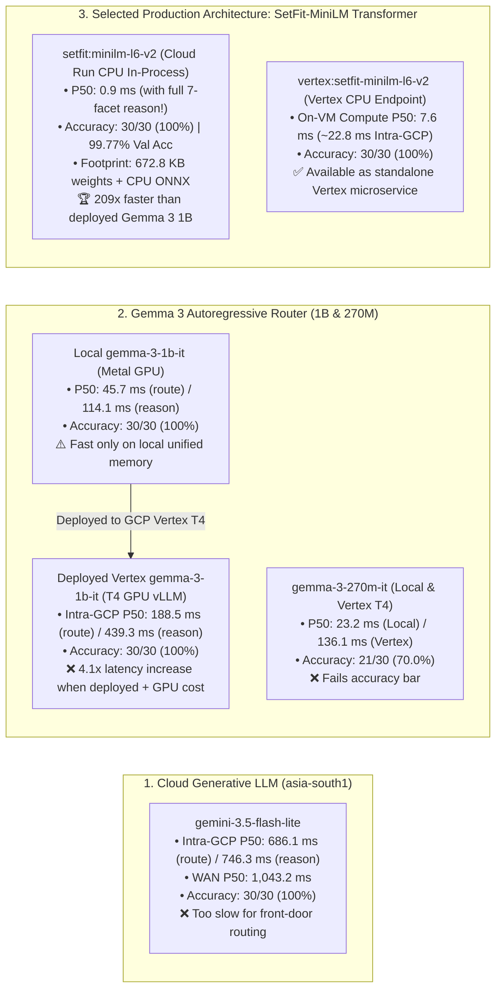

# Executive Summary: Query Decision Router (`/api/route_decision`) Experiments

## 1. Executive Summary & Recommendation

> [!IMPORTANT]
> **Architectural Recommendation:** Based on our latency, accuracy, and cost benchmarks in `asia-south1`, we recommend proceeding with the **SetFit / `all-MiniLM-L6-v2` Contrastive Embedding Classifier (`setfit:minilm-l6-v2`)** for the front-door Query Decision Router ([`search_studio/router_api.py`](file://./search_studio/router_api.py)) over **Gemma 3 (`1B` / `270M`)** and **Gemini 3.5 Flash Lite**. All benchmarked models remain integrated and selectable via the API so the team can evaluate or switch between them at any time.

* **Why Not Gemma 3 in Production?** While `gemma-3-1b-it-qat-4bit` is fast on a local Mac (`45.7 ms` P50) because it reuses a pre-warmed 415-token KV cache directly in Apple unified Metal memory, **deploying Gemma 3 to GCP Vertex AI (`asia-south1` on NVIDIA T4 GPU + vLLM) increases P50 latency to `188.5 ms` (route-only) and `439.3 ms` (with reason)** due to per-request prompt prefill, autoregressive token generation, and GPU serving overhead. The smaller `gemma-3-270m-it` model is faster (`23.2 ms` local), but its accuracy drops to **`70.0%` (`21/30`)**.
* **Why Not Gemini 3.5 Flash Lite?** Even with `thinkingBudget: 0` and intra-GCP `asia-south1` colocation, `gemini-3.5-flash-lite` takes **`686.1 ms` P50 (`1,335.8 ms` P95)** for route-only and **`746.3 ms` P50** with reason (`1,043–1,159 ms` over WAN). Spending `~700 ms` at the front door just to decide *whether* to invoke an LLM negates the latency savings of routing.
* **Why SetFit-MiniLM (`setfit:minilm-l6-v2`) Wins:** By reframing routing from *autoregressive text generation* to a *single-pass contrastive embedding classification* (`all-MiniLM-L6-v2` ONNX + 128-d Contrastive Projection Head + 7 Facet Heads), we achieve **`0.9 ms` P50 latency** in-process on Cloud Run CPU (**`7.6 ms` P50 compute / `22.8 ms` intra-GCP** on a dedicated Vertex AI CPU Endpoint), **`30/30 (100.0%)` accuracy**, **`15/15 (100.0%)` filter-query recall**, and **zero GPU cost**.

---

## 2. Problem Statement & Role of the Decision Router

Every incoming search query must be routed into one of two execution paths before hitting Vertex AI Agent Search ([`search_studio/search_service.py`](file://./search_studio/search_service.py)):

1. **`DIRECT_AGENT_SEARCH` (`call_llm_for_intent = false`)**:
   * **Target Queries (~50–65% of traffic):** Pure movie titles (*"Spider-Man: No Way Home"*, *"Pushpa 2"*), artist/tour names (*"Diljit Dosanjh Dil-Luminati"*, *"Zakir Khan show"*), standalone venues (*"Prithvi Theatre"*, *"Nita Mukesh Ambani Cultural Centre"*), and bank/card offers (*"ICICI credit card movie offer"*).
   * **Execution Path:** Bypasses the LLM Intent Extractor completely (`0 ms` NLU overhead) and dispatches straight to Vertex AI Agent Search.
2. **`CALL_LLM_INTENT` (`call_llm_for_intent = true`)**:
   * **Target Queries (~35–50% of traffic):** Queries containing any structured facet or constraint—city/locality (*"in Mumbai"*, *"near Koramangala"*), price (*"under 500"*, *"between 1000 and 3000"*), date/time (*"tonight"*, *"this Sunday"*, *"after 9 pm"*), format/seating (*"IMAX 3D"*, *"recliner seats"*, *"English subtitles"*), language, genre/category, or negation (*"without any horror"*, *"isnt a movie"*).
   * **Execution Path:** Invokes the 8-Key LLM Slot Extractor ([`search_studio/intent_extractor.py`](file://./search_studio/intent_extractor.py)) + Deterministic Taxonomy Compiler ([`search_studio/compiler.py`](file://./search_studio/compiler.py)) to build `conditionBoostSpecs`.

> [!WARNING]
> **Strict Latency Budget:** Because the router runs synchronously on **100% of search traffic**, any latency added by the router directly penalizes *both* fast direct lookups and complex NLU queries. A production router must add **< 25 ms** of overhead while maintaining **100% recall** on `CALL_LLM_INTENT` queries.

---

## 3. Master Comparison Across All 4 Experimental Phases

All models were evaluated on the same **30-query uncached benchmark (`ROUTER_BENCHMARK_30`)** in [`search_studio/router_api.py`](file://./search_studio/router_api.py#L842-L876) (15 direct entity/title/venue/offer lookups + 15 multi-constraint filter/boost queries):

| Experiment / Model | Deployment Environment | Hardware Required | P50 Latency (Route Only) | P50 Latency (With Reason) | P95 Latency (Route Only) | `CALL_LLM_INTENT` Recall | Overall Accuracy (`30` Queries) | Production Verdict |
| :--- | :--- | :---: | :---: | :---: | :---: | :---: | :---: | :--- |
| **1. `gemini-3.5-flash-lite`** *(WAN)* | Local $\rightarrow$ Vertex AI (`asia-south1`) | Managed Cloud | `1,043.2 ms` | `1,159.2 ms` | `1,427.4 ms` | `15/15 (100%)` | `30/30 (100%)` | ❌ Too slow (`>1s`) |
| **2. `gemini-3.5-flash-lite`** *(Intra-GCP)* | Cloud Run $\rightarrow$ Vertex AI (`asia-south1`) | Managed Cloud | `686.1 ms` | `746.3 ms` | `1,335.8 ms` | `15/15 (100%)` | `30/30 (100%)` | ❌ High latency (`~700 ms`) |
| **3. `gemma-3-270m-it`** *(Local MLX)* | Local Mac (`mlx-lm` 4-bit) | Apple Metal GPU | `23.2 ms` | `78.5 ms` | `24.5 ms` | `15/15 (100%)` | `21/30 (70.0%)` | ❌ Low accuracy (`70%`) |
| **4. `gemma-3-270m-it`** *(Vertex vLLM)* | Cloud Run $\rightarrow$ Vertex Endpoint (`asia-south1`) | `1x NVIDIA T4` GPU | `136.1 ms` | `298.4 ms` | `155.1 ms` | `15/15 (100%)` | `22/30 (73.3%)` | ❌ Low accuracy + GPU cost |
| **5. `gemma-3-1b-it`** *(Local MLX)* | Local Mac (`mlx-lm` 4-bit, 415-tok KV) | Apple Metal GPU | `45.7 ms` | `114.1 ms` | `53.3 ms` | `15/15 (100%)` | `30/30 (100%)` | ⚠️ Fast locally only |
| **6. `gemma-3-1b-it`** *(Vertex vLLM)* | Cloud Run $\rightarrow$ Vertex Endpoint (`asia-south1`) | `1x NVIDIA T4` GPU | `188.5 ms` | `439.3 ms` | `249.5 ms` | `15/15 (100%)` | `30/30 (100%)` | ❌ `4.1x` slower when deployed |
| **7. `vertex:setfit-minilm-l6-v2`** | Cloud Run $\rightarrow$ Vertex CPU Endpoint (`asia-south1`) | `n1-standard-2` CPU | **`7.6 ms`** *(on-VM)* `22.8 ms` *(RPC)* | **`7.6 ms`** *(on-VM)* `22.8 ms` *(RPC)* | `31.8 ms` | **`15/15 (100%)`** | **`30/30 (100%)`** | ✅ Dedicated Vertex Option |
| **8. `setfit:minilm-l6-v2`** *(Selected)* | **In-Process ONNX on Cloud Run (`asia-south1`)** | **Standard CPU (`0 GPU`)** | **`0.9 ms`** | **`0.9 ms`** | **`1.3 ms`** | **`15/15 (100%)`** | **`30/30 (100%)`** | 🏆 **Production Winner** |

---

## 4. Deep-Dive: Key Findings from Each Experiment

### Experiment 1: Cloud `gemini-3.5-flash-lite` (`asia-south1`)
* **What We Tested:** Calling Vertex AI `gemini-3.5-flash-lite` in `asia-south1` with `thinkingBudget: 0`, `temperature: 0.0`, compact system instructions, and persistent HTTP keep-alive connections, both from Local Mac (WAN) and from a colocated Cloud Run service in `asia-south1` (Intra-GCP).
* **Results:**
  * **Accuracy:** `30/30 (100.0%)`.
  * **Latency:** Colocating in `asia-south1` reduced P50 latency from `1,043.2 ms` to **`686.1 ms`** (`746.3 ms` with reason), with P95 spikes up to **`1,335.8 ms`**.
* **Why It Was Rejected for Routing:** Adding `~700 ms` of blocking front-door latency to every search request makes `DIRECT_AGENT_SEARCH` queries `3x` slower than calling Vertex AI Agent Search directly (`~200–250 ms`).

---

### Experiment 2: Gemma 3 (`270M` vs. `1B`) — Local Metal GPU vs. GCP Vertex AI Deployment
* **What We Tested:**
  1. **Local Apple Silicon (`mlx-lm` 4-bit QAT)** with a pre-warmed multi-turn KV cache (`_MLX_ROUTER_RUNTIMES`).
  2. **GCP Vertex AI Online Prediction (`asia-south1`)** using the official vLLM container on `n1-standard-8` + `1x NVIDIA_TESLA_T4` GPU (`Endpoint 5229789674121199616`).
* **Accuracy Engineering on Gemma 3 (`83.3%` $\rightarrow$ `100.0%` on `1B`):**
  * Initially, `gemma-3-1b-it` scored `25/30 (83.3%)` because our 500–644 token few-shot prompt overflowed Gemma 3's **512-token local sliding attention window (`RotatingKVCache`)**, causing the model to forget early system instructions and misclassify standalone venues (*"Nita Mukesh Ambani Cultural Centre"*) and bank offers (*"ICICI credit card movie offer"*).
  * Furthermore, `rawPredict` on vLLM automatically prepends `<bos>`, so an explicit `<bos>` in the prompt created a duplicate `<bos><bos>` token sequence that degraded vLLM accuracy.
  * By removing the duplicate `<bos>`, compacting [`build_gemma_router_chat_messages()`](file://./search_studio/prompts.py#L218-L263) to **415 tokens** (`415 + 40 < 512`), and adding deterministic facet guardrails ([`_apply_router_facet_guardrail()`](file://./search_studio/router_api.py#L101-L133)), `gemma-3-1b-it` reached **`30/30 (100.0%)` accuracy**.
* **Why Gemma 3 Was Rejected for Production Deployment:**
  * **The Local-to-Cloud Latency Gap (`45.7 ms` $\rightarrow$ `188.5 ms` / `439.3 ms`):**
    * Locally, `mlx-lm` snapshots the 415-token KV cache in unified GPU memory and only evaluates the ~12 new query tokens (`45.7 ms` P50).
    * When deployed on GCP Vertex AI (`Endpoint 5229789674121199616`), each stateless HTTP request must serialize the full 415-token prompt over the network, run vLLM prefill + autoregressive decoding on the T4 GPU, and return the response—pushing intra-GCP P50 latency to **`188.5 ms`** (`include_reason=false`) and **`439.3 ms`** (`include_reason=true`).
  * **270M Capacity Bottleneck:** `gemma-3-270m-it` reduced Vertex latency to `136.1 ms`, but could only achieve **`70.0%–73.3%` accuracy** (aggressively over-predicting `CALL_LLM_INTENT` on standalone titles).
  * **Always-On GPU Cost:** Running a dedicated Vertex AI GPU endpoint (`n1-standard-8` + `T4`) purely for binary routing costs ~`$250–$300+/month` per replica even during idle periods.

---

### Experiment 3: SetFit / `all-MiniLM-L6-v2` Contrastive Transformer (`setfit:minilm-l6-v2`)
* **What We Built ([`train_setfit_router.py`](file://./train_setfit_router.py)):**
  * **Contrastive Bi-Encoder Architecture:**
    1. **Base Encoder (`384-d`):** `sentence-transformers/all-MiniLM-L6-v2` running in `onnxruntime` on CPU with dynamic unpadded sequence length (`tokenizer.no_padding()`), encoding short 4–12 token search queries in **`0.85 ms`**.
    2. **SetFit Contrastive Projection Head (`384 -> 256 -> 128`):** Trained on **40,000 positive & negative query pairs** from **2,215 domain-specific queries** (including hard-negative movie titles with city/date/price words like *"Delhi Belly"*, *"Mumbai Police"*, *"Friday the 13th"*, *"Free Guy"*). Trained on Apple Metal GPU in **1.75 seconds** (`Cosine Contrastive Loss: 0.02856 -> 0.00017`).
    3. **Multi-Head Classification (`512-d`):** 1 primary `LogisticRegression` route head (`DIRECT_AGENT_SEARCH` vs. `CALL_LLM_INTENT` + confidence) + **7 parallel facet heads** (`city`, `date_time`, `price`, `format`, `language`, `genre_category`, `negation`) that generate structured human-readable reasons in **`0.03 ms`** without generating tokens!
* **Results:**
  * **Held-Out Validation Accuracy (443 unseen queries):** **`99.77%` accuracy** (`99.85%` F1).
  * **30-Query Benchmark Accuracy (both in-sample & strict out-of-sample):** **`30/30 (100.0%)` accuracy**, **`15/15 (100.0%)` recall**.
  * **Latency (`include_reason=false` AND `include_reason=true`):**
    * **In-Process on Cloud Run CPU (`setfit:minilm-l6-v2`):** **`0.9 ms` P50** (`0.8 ms` min, `1.3 ms` P95)—**`209x` faster** than Vertex Gemma 3 1B (`188.5 ms`) and **`762x` faster** than Intra-GCP Gemini 3.5 Flash Lite (`686.1 ms`).
    * **Dedicated Vertex AI CPU Endpoint (`vertex:setfit-minilm-l6-v2`, Endpoint `1848149303919378432`):** **`7.6 ms` P50 on-VM compute** (`22.8 ms` P50 intra-GCP round-trip)—**`8.3x` faster** than Vertex Gemma 3 1B while running on a standard CPU VM (`n1-standard-2`) with zero GPU cost.

---

## 5. Visual Comparison: Latency vs. Accuracy Across Deployment Targets

---

## 6. Production Architecture & Operational Summary

* **Default Production Router (`model="setfit:minilm-l6-v2"`):**
  * Runs in-process inside the Cloud Run API service (`https://ent-agent-search-api-gdlqvkt5tq-el.a.run.app` in `asia-south1`) and local Search Studio server ([`search_studio/router_api.py`](file://./search_studio/router_api.py)).
  * Pre-warmed at container startup (`lifespan` hook in [`cloud_run_api/api_server.py`](file://./cloud_run_api/api_server.py)), delivering **`0.9 ms` P50** routing with **zero external network hop** and **zero GPU cost**.
* **Dedicated Vertex AI Endpoint Option (`model="vertex:setfit-minilm-l6-v2"`):**
  * Deployed on Vertex AI Online Prediction in `asia-south1` (`Endpoint ID: 1848149303919378432`, `Model ID: 3819136046893891584`) for any external service that wants to query the router directly via Vertex `:predict` (`7.6 ms` P50 compute).
* **Effortless Re-Training (< 4 Seconds):**
  * Adding new domain patterns or hard-negative titles requires editing [`build_training_dataset()`](file://./train_setfit_router.py#L46-L246) in [`train_setfit_router.py`](file://./train_setfit_router.py) and running `./.venv/bin/python train_setfit_router.py` (**~3.5 seconds** end-to-end on Apple Silicon) to regenerate [`search_studio/setfit_minilm_router_weights.npz`](file://./search_studio/setfit_minilm_router_weights.npz).
* **Backward Compatibility:**
  * All benchmarked models (`setfit:minilm-l6-v2`, `vertex:setfit-minilm-l6-v2`, `vertex:gemma-3-1b-it`, `local:gemma-3-1b-it-qat-4bit`, `local:gemma-3-270m-it-qat-4bit`, and `gemini-3.5-flash-lite`) remain selectable via the `"model"` parameter on `POST /api/route_decision` for ongoing A/B testing and benchmarking.
