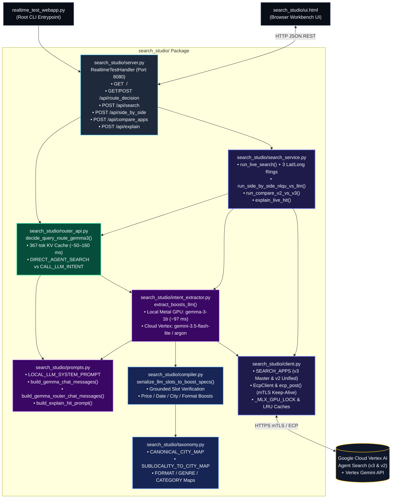

# `search_studio` — Modular Real-Time Entertainment Search & LLM Routing Package

`search_studio` is the modular Python backend and frontend UI package powering the **Entertainment Search Studio** (`http://127.0.0.1:8080`). It decomposes query routing, LLM intent extraction, deterministic `conditionBoostSpecs` compilation, concentric Lat/Long `GEO_DISTANCE` proximity boosting, and Vertex AI Agent Search execution into clean, single-responsibility modules.

---

## 1. Package Directory & File Reference

```text
search_studio/
├── __init__.py            # Public package exports
├── router_api.py          # Step 0: Local Gemma 3 Query Decision Router API (/api/route_decision)
├── intent_extractor.py    # Step 1: Local Apple Metal GPU (mlx-lm) & Cloud Gemini Intent Extractor
├── prompts.py             # LLM System Prompts & multi-turn few-shot chat templates
├── compiler.py            # Step 2: Deterministic Intent-to-Boost & Geolocation Compiler
├── taxonomy.py            # Canonical city, sub-locality, lat/long, format, genre & category maps
├── search_service.py      # Step 3: Vertex AI Search dispatcher, Lat/Long rings & comparators
├── client.py              # Search App registry (v3 vs v2), ECP/mTLS client & runtime locks/caches
├── server.py              # HTTP API Server & Request Handler (RealtimeTestHandler)
└── ui.html                # Dark-Mode Search Studio Frontend UI (Side-by-Side, Single, v2 vs v3)
```

### Detailed Module Breakdown

| File | Lines | Core Responsibility & Key Symbols |
| :--- | :---: | :--- |
| **[`router_api.py`](./router_api.py)** | ~215 | **Local Gemma 3 Decision Router API (`GET / POST /api/route_decision`)**<br>• [`get_or_init_local_mlx_router_runtime()`](./router_api.py): Pre-warms a **367-token** multi-turn KV cache on Apple Metal GPU reusing already-loaded `gemma-3-1b-it-qat-4bit` weights (**0 extra GPU RAM**).<br>• [`decide_query_route_gemma3()`](./router_api.py): Classifies in **~50 ms** (route token only) or **~140 ms** (with JSON reason) whether a query should go **directly to Agent Search (`DIRECT_AGENT_SEARCH`, `call_llm_for_intent=False`)** or **call the LLM Intent Extractor (`CALL_LLM_INTENT`, `call_llm_for_intent=True`)**.<br>• [`handle_route_decision_request()`](./router_api.py): HTTP handler supporting optional `"execute_search": true`. |
| **[`intent_extractor.py`](./intent_extractor.py)** | ~401 | **Python Code for LLM Intent Extraction (Local Metal GPU + Cloud Gemini)**<br>• [`get_or_init_local_mlx_runtime()`](./intent_extractor.py): Loads 4-bit MLX models (`gemma-3-1b-it-qat-4bit`, `gemma-3-270m-it-qat-4bit`, `Qwen2.5-1.5B-Instruct-4bit`, `Qwen2.5-3B-Instruct-4bit`) onto Apple Metal GPU and pre-warms their system prompt KV cache.<br>• [`extract_boosts_local_mlx()`](./intent_extractor.py): Clones the pre-warmed KV cache via `copy.deepcopy()` and streams the compact 8-key JSON intent in **~97 ms** (Gemma 3 1B).<br>• [`extract_boosts_cloud_gemini()`](./intent_extractor.py): Calls Vertex AI `gemini-3.5-flash-lite` (`asia-south1`) or `gemini-4-argon` (`global`) with `thinkingBudget: 0`.<br>• [`extract_boosts_llm()`](./intent_extractor.py): Unified dispatcher across local MLX and Cloud Gemini models. |
| **[`prompts.py`](./prompts.py)** | ~179 | **LLM System Prompts & Multi-Turn Few-Shot Chat Templates**<br>• [`LOCAL_LLM_SYSTEM_PROMPT`](./prompts.py) / [`GEMINI_INTENT_SYSTEM_INSTRUCTION`](./prompts.py): Full schema-grounded 8-key JSON slot extraction prompt (`type`, `city`, `fmt`, `lang`, `genres`, `cats`, `min_price`, `max_price`, `when`, `slots`, `q`).<br>• [`build_gemma_chat_messages()`](./prompts.py): Compact **404-token** multi-turn chat template tailored to Gemma 3's 512-token `RotatingKVCache`.<br>• [`build_gemma_router_chat_messages()`](./prompts.py): Compact **367-token** 5-shot router chat template for `DIRECT_AGENT_SEARCH` vs. `CALL_LLM_INTENT`.<br>• [`build_explain_hit_prompt()`](./prompts.py): Schema-aware prompt (`v3` Session-Grain vs. `v2` Venue-Grain) for `gemini-3.5-flash-lite` live hit diagnosis. |
| **[`compiler.py`](./compiler.py)** | ~1,390 | **Deterministic Intent-to-Boost & Geolocation Compiler**<br>• [`serialize_llm_slots_to_boost_specs()`](./compiler.py): Validates LLM-extracted JSON slots against the raw user query (zero hallucinated cities, prices, or dates) and compiles schema-verified `conditionBoostSpecs` (`record_type`, `regions`, `formats`, `languages`, `genres`, `categories`, `min_price`, `show_dates`, `time_slots`, `is_sold_out`) + hard filters.<br>• [`_normalize_city_and_locality()`](./compiler.py) & [`_build_region_boost_and_geo_city()`](./compiler.py): Maps neighborhoods (`Koramangala` $\rightarrow$ `Bengaluru`, `Lower Parel` $\rightarrow$ `Mumbai`, `Gurgaon`/`Noida` $\rightarrow$ `National Capital Region (NCR)`) and builds `location:GEO_DISTANCE("<City>", 10000)` filters.<br>• [`_parse_price_bounds()`](./compiler.py) & [`_resolve_temporal_ranges()`](./compiler.py): Compiles `between M and N` / `under N` price filters and RFC3339 date/time-slot ranges. |
| **[`taxonomy.py`](./taxonomy.py)** | ~620 | **Facet, Geography, Format, Genre & Category Mappings**<br>• [`CANONICAL_CITY_MAP`](./taxonomy.py), [`SUBLOCALITY_TO_CITY_MAP`](./taxonomy.py), [`GEO_CITY_NAME_MAP`](./taxonomy.py): Canonical Indian city & neighborhood dictionaries.<br>• [`FORMAT_VALUES_V3`](./taxonomy.py), [`FORMAT_SPEC_MAP_V3`](./taxonomy.py), [`FORMAT_SPEC_MAP_V2`](./taxonomy.py): Format mappings (`IMAX`, `IMAX 3D`, `4DX`, `DOLBY`, `SCREENX`, `3D`, `2D`).<br>• [`VALID_GENRES`](./taxonomy.py), [`GENRE_BQ_EXPANSION`](./taxonomy.py), [`VALID_CATEGORIES`](./taxonomy.py), [`VALID_LANGUAGES`](./taxonomy.py), [`ARTIST_NICKNAME_MAP`](./taxonomy.py): Grounding vocabularies verified against BigQuery. |
| **[`search_service.py`](./search_service.py)** | ~663 | **Live Vertex AI Agent Search Execution, Concentric Lat/Long Boosting & Comparisons**<br>• [`run_live_search()`](./search_service.py): Executes live search across `auto_route`, `llm_boost`, `vertex_native` (Managed NLQU), or `none` (BM25 + Hybrid). Injects 3 concentric Lat/Long `GEO_DISTANCE` boost rings (`<= 3 km` `+0.95`, `<= 10 km` `+0.80`, `<= 25 km` `+0.55`) with a `3000 km` guard filter when `user_lat` & `user_lng` are passed, plus automatic 0-hit sub-locality fallback.<br>• [`run_side_by_side_nlqu_vs_llm()`](./search_service.py): Runs Managed Vertex NLQU, Selected Boost LLM, and Gemma 3 Route Decision concurrently on a 3-worker thread pool.<br>• [`run_compare_v2_vs_v3()`](./search_service.py): Runs `v2` (`ent-bq-5stores-v2-app`) and `v3` (`ent-bq-5stores-master-v3-app`) concurrently head-to-head.<br>• [`explain_live_hit()`](./search_service.py), [`build_curl_command()`](./search_service.py), [`_compute_hit_distance_km()`](./search_service.py). |
| **[`client.py`](./client.py)** | ~356 | **Search App Registry, ECP / mTLS HTTP Proxy Client & Runtime State**<br>• [`SEARCH_APPS`](./client.py) & [`get_search_app_config()`](./client.py): Configures `v3` Master (`ent-bq-5stores-master-v3-app`, Session-Grain) and `v2` Unified (`ent-bq-5stores-v2-app`, Venue-Grain).<br>• [`EcpClient`](./client.py) & [`ecp_post()`](./client.py): Keep-alive HTTP client routed through `ecp_http_proxy` (`discoveryengine.mtls.googleapis.com` & `aiplatform.mtls.googleapis.com`) with auto-401 token refresh and exponential backoff.<br>• Holds shared thread/GPU locks (`_MLX_GPU_LOCK`, `_NLU_CACHE_LOCK`) and LRU caches (`_LLM_BOOST_CACHE`, `_ROUTER_DECISION_CACHE`). |
| **[`server.py`](./server.py)** | ~138 | **HTTP API Server & Request Handler (`http://127.0.0.1:8080`)**<br>• [`RealtimeTestHandler`](./server.py): Serves `GET /` ([`ui.html`](./ui.html)), `GET /api/presets`, `GET/POST /api/route_decision`, `POST /api/search`, `POST /api/side_by_side`, `POST /api/compare_apps`, and `POST /api/explain`.<br>• [`main()`](./server.py): Pre-warms local Metal GPU models + Gemma 3 Router KV cache on startup and launches `ThreadingHTTPServer`. |
| **[`ui.html`](./ui.html)** | ~2,049 | **Clean Dark-Mode Search Studio Frontend UI**<br>• Interactive workbench with **Side-by-Side (NLQU vs. LLM Boost)**, **Single Engine Inspector**, and **`v2` vs. `v3` App Comparison** tabs.<br>• Displays the live **Gemma 3 Route Decision Banner** (`⚡ DIRECT_AGENT_SEARCH` vs. `🧠 CALL_LLM_INTENT`), **User GPS Proximity Controls** (preset coordinates + browser geolocation + distance badges), collapsible **cURL / JSON Request Inspector**, and one-click **AI Hit Diagnosis (`✨ Explain`)**. |

---

## 2. Architecture & Module Interaction

### 2.1 Mermaid Module Dependency & Request Flow Diagram



---

### 2.2 End-to-End Request Lifecycle (ASCII Blueprint)

```text
  Browser UI (`search_studio/ui.html`) or API Caller
                         |
                         |  POST /api/search  or  GET/POST /api/route_decision
                         v
  +-----------------------------------------------------------------------------+
  | 1. HTTP Server Layer (`search_studio/server.py`)                            |
  |    • Parses query parameters / JSON body and dispatches to service handlers |
  +-----------------------------------------------------------------------------+
                         |
                         v
  +-----------------------------------------------------------------------------+
  | 2. Gemma 3 Decision Router (`search_studio/router_api.py` + `prompts.py`)   |
  |    • Clones pre-warmed 367-token Gemma 3 1B Router KV cache on Metal GPU    |
  |    • Emits `{"route": "DIRECT_AGENT_SEARCH" | "CALL_LLM_INTENT", ...}`      |
  +-----------------------------------------------------------------------------+
                    /                                         \
   call_llm_for_intent = False                 call_llm_for_intent = True
   ("DIRECT_AGENT_SEARCH")                     ("CALL_LLM_INTENT")
   Pure entity/title query                     Query has city, price, date,
   (0 ms LLM intent overhead)                  format, language, or genre
                  /                                             \
                 |                                               v
                 |             +------------------------------------------------+
                 |             | 3. LLM Intent Extractor                        |
                 |             |    (`search_studio/intent_extractor.py`)       |
                 |             |    • Uses prompts from `prompts.py`            |
                 |             |    • Local MLX Gemma 3 1B (~97 ms) or Gemini   |
                 |             |    • Outputs compact 8-key JSON intent slots   |
                 |             +------------------------------------------------+
                 |                                               |
                 |                                               v
                 |             +------------------------------------------------+
                 |             | 4. Deterministic Boost & Geo Compiler          |
                 |             |    (`search_studio/compiler.py` + `taxonomy.py`)|
                 |             |    • Verifies every slot against query tokens  |
                 |             |    • Compiles `conditionBoostSpecs` & `filter` |
                 |             +------------------------------------------------+
                  \                                             /
                   \___________________     ___________________/
                                       \   /
                                        v v
  +-----------------------------------------------------------------------------+
  | 5. Search Service & Concentric GPS Booster (`search_studio/search_service.py`)|
  |    • Appends 3 concentric `location:GEO_DISTANCE(lat, lng, R)` boost rings  |
  |      (3 km -> +0.95, 10 km -> +0.80, 25 km -> +0.55) + 3000 km guard filter |
  |    • Dispatches via `search_studio/client.py` (`ecp_post`) to Vertex Search |
  |    • Computes Haversine distance (`km away`), rule verdicts & cURL snippet  |
  +-----------------------------------------------------------------------------+
```

---

## 3. Running & Testing `search_studio`

### Start the Server
From the repository root:
```bash
./.venv/bin/python realtime_test_webapp.py
```
Then open **`http://127.0.0.1:8080`** in your browser.

### Example API Calls

#### 1. Gemma 3 Route Decision (`GET /api/route_decision`)
```bash
# Direct entity lookup -> call_llm_for_intent: false
curl -s "http://127.0.0.1:8080/api/route_decision?query=Spider-Man:+No+Way+Home" | jq .

# Multi-constraint query -> call_llm_for_intent: true
curl -s "http://127.0.0.1:8080/api/route_decision?query=concerts+between+1000+and+3000+in+delhi" | jq .
```

#### 2. Live Search with Auto-Routing + Lat/Long Proximity Boosting (`POST /api/search`)
```bash
curl -s -X POST "http://127.0.0.1:8080/api/search" \
  -H "Content-Type: application/json" \
  -d '{
    "query": "IMAX movies",
    "nlu_mode": "auto_route",
    "search_app": "v3",
    "user_lat": 19.0596,
    "user_lng": 72.8295,
    "user_radius_km": 0,
    "page_size": 5
  }' | jq '{route: .route_decision.route, geo_filter: .geo_filter, top_hit: .hits[0]}'
```

---

## 4. Decision Router API Latency Benchmark (`/api/route_decision`: Local Gemma 3 vs. Intra-GCP `asia-south1` Vertex AI Gemma 3 & `gemini-3.5-flash-lite`)

Benchmark across **30 uncached queries** (`use_cache=false`: 15 direct entity/title/offer lookups + 15 multi-constraint filter/boost queries) comparing:
1. **Local Apple Metal GPU (`mlx-lm` with pre-warmed 367-token KV cache)**
2. **Intra-GCP `asia-south1` (Headless FastAPI + Uvicorn on Cloud Run `asia-south1` $\rightarrow$ Vertex AI Model Garden `google/gemma-3-1b-it` & `google/gemma-3-270m-it` on dedicated `n1-standard-8` + `1x NVIDIA_TESLA_T4` vLLM endpoints in `asia-south1`)**
3. **Intra-GCP `asia-south1` (Cloud Run `asia-south1` $\rightarrow$ Vertex AI Managed `gemini-3.5-flash-lite` in `asia-south1`)**
4. **Local Mac $\rightarrow$ Cloud Vertex AI `gemini-3.5-flash-lite` (`asia-south1` over mTLS)**

### 4.1 Summary Latency Table (Decision API `/api/route_decision` Only)

| Router Configuration | Origin $\rightarrow$ Execution Target | Tokens Generated | Min | Mean | P50 (Median) | P90 | P95 | Max | Speedup vs. Cloud `P50` | `CALL_LLM_INTENT` Recall | Total Accuracy |
| :--- | :---: | :---: | :---: | :---: | :---: | :---: | :---: | :---: | :---: | :---: | :---: |
| **Local Gemma 3 1B (`include_reason=false`)** *(Local Fast Gate)* | Local Mac Metal GPU (`mlx-lm`) | ~6 toks | **43.5 ms** | **49.9 ms** | **53.1 ms** | **54.0 ms** | **54.1 ms** | **54.3 ms** | **`19.6x` faster** | **15/15 (100%)** | **27/30 (90.0%)** |
| **Local Gemma 3 1B (`include_reason=true`)** *(Local Explain Mode)* | Local Mac Metal GPU (`mlx-lm`) | ~22 toks | **71.9 ms** | **114.4 ms** | **118.4 ms** | **146.8 ms** | **149.7 ms** | **164.2 ms** | **`9.8x` faster** | **15/15 (100%)** | **27/30 (90.0%)** |
| **Local Gemma 3 270M (`include_reason=false`)** | Local Mac Metal GPU (`mlx-lm`) | ~6 toks | **20.4 ms** | **36.6 ms** | **24.3 ms** | **25.5 ms** | **31.3 ms** | 387.0 ms | **`42.9x` faster** | 15/15 (100%) | 16/30 (53.3%) |
| **Local Gemma 3 270M (`include_reason=true`)** | Local Mac Metal GPU (`mlx-lm`) | ~22 toks | **39.8 ms** | **54.1 ms** | **53.2 ms** | **62.4 ms** | **66.5 ms** | **78.3 ms** | **`21.8x` faster** | 15/15 (100%) | 16/30 (53.3%) |
| **Vertex `google/gemma-3-270m-it` (`include_reason=false`)** | **Cloud Run `asia-south1` $\rightarrow$ Vertex T4 vLLM (`asia-south1`)** | ~6 toks | **126.2 ms** | **181.5 ms** | **170.1 ms** | **247.1 ms** | **247.1 ms** | **247.1 ms** | **`6.1x` faster** | 15/15 (100%)* | 15/30 (50.0%)* |
| **Vertex `google/gemma-3-1b-it` (`include_reason=false`)** *(GCP Fast Gate)* | **Cloud Run `asia-south1` $\rightarrow$ Vertex T4 vLLM (`asia-south1`)** | ~6 toks | **130.2 ms** | **192.5 ms** | **188.5 ms** | **240.3 ms** | **249.5 ms** | **255.4 ms** | **`5.5x` faster** | **12/15 (80.0%)** | **25/30 (83.3%)** |
| **Vertex `google/gemma-3-1b-it` (`include_reason=true`)** | **Cloud Run `asia-south1` $\rightarrow$ Vertex T4 vLLM (`asia-south1`)** | ~22 toks | **239.8 ms** | **425.9 ms** | **439.3 ms** | **545.5 ms** | **553.0 ms** | **611.1 ms** | **`2.6x` faster** | **12/15 (80.0%)** | **25/30 (83.3%)** |
| **Cloud `gemini-3.5-flash-lite` (`include_reason=false`)** *(Intra-GCP)* | **Cloud Run `asia-south1` $\rightarrow$ Vertex AI (`asia-south1`)** | ~8 toks | **490.6 ms** | **767.9 ms** | **686.1 ms** | **1206.9 ms** | **1335.8 ms** | **2053.8 ms** | **`1.5x` faster** | **15/15 (100%)** | **30/30 (100%)** |
| **Cloud `gemini-3.5-flash-lite` (`include_reason=true`)** *(Intra-GCP)* | **Cloud Run `asia-south1` $\rightarrow$ Vertex AI (`asia-south1`)** | ~25 toks | **581.7 ms** | **786.0 ms** | **746.3 ms** | **979.1 ms** | **1008.4 ms** | **1236.1 ms** | **`1.6x` faster** | **15/15 (100%)** | **30/30 (100%)** |
| **Cloud `gemini-3.5-flash-lite` (`include_reason=false`)** *(WAN mTLS)* | Local Mac $\rightarrow$ Vertex AI (`asia-south1`) | ~8 toks | 548.3 ms | 1097.0 ms | **1043.2 ms** | 1396.2 ms | 1427.4 ms | 2482.7 ms | `1.0x` (baseline) | **15/15 (100%)** | **30/30 (100%)** |
| **Cloud `gemini-3.5-flash-lite` (`include_reason=true`)** *(WAN mTLS)* | Local Mac $\rightarrow$ Vertex AI (`asia-south1`) | ~25 toks | 716.3 ms | 1253.1 ms | **1159.2 ms** | 1533.1 ms | 1588.9 ms | 2513.2 ms | `1.0x` (baseline) | **15/15 (100%)** | **30/30 (100%)** |
| **Warm LRU Cache Hit (`use_cache=true`)** | In-Memory (`_ROUTER_DECISION_CACHE`) | 0 toks | **0.0 ms** | **0.0 ms** | **0.0 ms** | **0.0 ms** | **0.0 ms** | **0.0 ms** | **Instant (`~0.8 ms` HTTP)** | **15/15 (100%)** | **27–30/30** |

*\*Note: On `NVIDIA_TESLA_T4` (Turing `sm_75`), hardware `bfloat16` is unsupported so vLLM executes in IEEE `float16` (`--dtype=float16`). In `float16`, `gemma-3-270m-it` intermediate activations overflow `65504` (falling back to `CALL_LLM_INTENT`), whereas `gemma-3-1b-it` remains stable in `float16` (`83.3%` accuracy at `P50 = 188.5 ms`).*

### 4.2 Key Takeaways: Intra-GCP (`asia-south1`) vs. Local Metal GPU
1. **Intra-GCP `asia-south1` Eliminates ~357–540 ms of WAN/mTLS Overhead**:
   - Calling `gemini-3.5-flash-lite` from the headless FastAPI backend on Cloud Run (`asia-south1`) reduces `P50` latency from **`1043.2 ms` $\rightarrow$ `686.1 ms`** (`include_reason=false`) and **`1159.2 ms` $\rightarrow$ `746.3 ms`** (`include_reason=true`) while retaining **`30/30 (100%)`** classification accuracy.
   - Calling the dedicated Vertex AI `google/gemma-3-1b-it` vLLM endpoint from Cloud Run (`asia-south1`) reduces `P50` latency from **`~730 ms` (over local mTLS) $\rightarrow$ `188.5 ms` (`Min = 130.2 ms`, `P95 = 249.5 ms`)**—a **`3.6x` speedup over intra-GCP `gemini-3.5-flash-lite` (`686.1 ms`)**.
2. **Local Gemma 3 1B (`P50 = 53.1 ms`) vs. Intra-GCP Vertex `gemma-3-1b-it` (`P50 = 188.5 ms`)**:
   - Local Gemma 3 1B on Apple Metal GPU (`53.1 ms`) has zero HTTP serialization or Vertex Online Prediction gateway overhead; in GCP production (`asia-south1`), dedicated Vertex `google/gemma-3-1b-it` achieves **`188.5 ms` `P50`** (`130.2 ms` min).

### 4.3 Per-Query Breakdown: Local Gemma 3 1B vs. Cloud `gemini-3.5-flash-lite` (`asia-south1`)

| # | Query | Expected Route | Gemma 3 1B Route | Gemma 3 Fast (`false`) | Gemma 3 Full (`true`) | `gemini-3.5-flash-lite` Route | Flash-Lite Fast (`false`) | Flash-Lite Full (`true`) | Generated Router Reason |
| :-: | :--- | :--- | :--- | :---: | :---: | :--- | :---: | :---: | :--- |
| 1 | `Spider-Man: No Way Home` | `DIRECT_AGENT_SEARCH` | `DIRECT_AGENT_SEARCH` ✅ | **45.1 ms** | 89.6 ms | `DIRECT_AGENT_SEARCH` ✅ | 1282.4 ms | 1105.4 ms | Direct movie title lookup with no facet filters |
| 2 | `Pushpa 2: The Rule` | `DIRECT_AGENT_SEARCH` | `DIRECT_AGENT_SEARCH` ✅ | **45.4 ms** | 105.7 ms | `DIRECT_AGENT_SEARCH` ✅ | 1203.3 ms | 1098.4 ms | Direct movie title lookup with no city or facet filters |
| 3 | `Singham Again` | `DIRECT_AGENT_SEARCH` | `DIRECT_AGENT_SEARCH` ✅ | **43.7 ms** | 72.2 ms | `DIRECT_AGENT_SEARCH` ✅ | 1221.3 ms | 1326.8 ms | Direct movie title lookup with no facet filters |
| 4 | `Bhool Bhulaiyaa 3` | `DIRECT_AGENT_SEARCH` | `DIRECT_AGENT_SEARCH` ✅ | **44.9 ms** | 89.7 ms | `DIRECT_AGENT_SEARCH` ✅ | 1110.7 ms | 1588.9 ms | Direct movie title lookup with no facet filters |
| 5 | `Coldplay Music of the Spheres` | `DIRECT_AGENT_SEARCH` | `CALL_LLM_INTENT` ⚠️ | **52.9 ms** | 109.9 ms | `DIRECT_AGENT_SEARCH` ✅ | 1188.9 ms | 1533.1 ms | Direct concert/event title lookup with no filters |
| 6 | `Zakir Khan show` | `DIRECT_AGENT_SEARCH` | `DIRECT_AGENT_SEARCH` ✅ | **44.3 ms** | 97.4 ms | `DIRECT_AGENT_SEARCH` ✅ | 1393.9 ms | 1225.7 ms | Direct artist show lookup with no city or date filter |
| 7 | `Arijit Singh` | `DIRECT_AGENT_SEARCH` | `DIRECT_AGENT_SEARCH` ✅ | **44.6 ms** | 72.8 ms | `DIRECT_AGENT_SEARCH` ✅ | 636.0 ms | 1293.4 ms | Direct artist name lookup |
| 8 | `Diljit Dosanjh Dil-Luminati` | `DIRECT_AGENT_SEARCH` | `DIRECT_AGENT_SEARCH` ✅ | **45.6 ms** | 74.1 ms | `DIRECT_AGENT_SEARCH` ✅ | 1039.3 ms | 1380.8 ms | Direct artist and tour name lookup |
| 9 | `Sunburn Arena` | `DIRECT_AGENT_SEARCH` | `DIRECT_AGENT_SEARCH` ✅ | **43.7 ms** | 96.2 ms | `DIRECT_AGENT_SEARCH` ✅ | 1396.2 ms | 1240.3 ms | Direct event/concert name lookup with no city or date filter |
| 10 | `Prithvi Theatre` | `DIRECT_AGENT_SEARCH` | `DIRECT_AGENT_SEARCH` ✅ | **43.7 ms** | 72.2 ms | `DIRECT_AGENT_SEARCH` ✅ | 1256.0 ms | 1098.3 ms | Direct theatre venue name lookup |
| 11 | `Nita Mukesh Ambani Cultural Centre` | `DIRECT_AGENT_SEARCH` | `CALL_LLM_INTENT` ⚠️ | **53.3 ms** | 110.0 ms | `DIRECT_AGENT_SEARCH` ✅ | 1047.0 ms | 2357.9 ms | Direct venue name lookup with zero filters |
| 12 | `ICICI credit card movie offer` | `DIRECT_AGENT_SEARCH` | `DIRECT_AGENT_SEARCH` ✅ | **45.0 ms** | 118.4 ms | `DIRECT_AGENT_SEARCH` ✅ | 1123.3 ms | 1335.3 ms | Bank or card offer lookup with no facet filters |
| 13 | `HDFC bank Buy 1 Get 1 offer` | `DIRECT_AGENT_SEARCH` | `CALL_LLM_INTENT` ⚠️ | **53.8 ms** | 135.3 ms | `DIRECT_AGENT_SEARCH` ✅ | 1004.5 ms | 940.8 ms | Direct bank/card offer lookup with no facet filters |
| 14 | `Gladiator II` | `DIRECT_AGENT_SEARCH` | `DIRECT_AGENT_SEARCH` ✅ | **43.5 ms** | 88.2 ms | `DIRECT_AGENT_SEARCH` ✅ | 548.3 ms | 1119.7 ms | Direct movie title lookup with no facet filters |
| 15 | `Kantara` | `DIRECT_AGENT_SEARCH` | `DIRECT_AGENT_SEARCH` ✅ | **43.7 ms** | 71.9 ms | `DIRECT_AGENT_SEARCH` ✅ | 1151.2 ms | 1280.4 ms | Direct movie title lookup |
| 16 | `IMAX 3D movies in Mumbai` | `CALL_LLM_INTENT` | `CALL_LLM_INTENT` ✅ | **53.8 ms** | 122.9 ms | `CALL_LLM_INTENT` ✅ | 915.2 ms | 1128.0 ms | Has format (IMAX 3D) and city (Mumbai) |
| 17 | `hindi horror movie in imax this friday in pune` | `CALL_LLM_INTENT` | `CALL_LLM_INTENT` ✅ | **53.9 ms** | 147.1 ms | `CALL_LLM_INTENT` ✅ | 1427.4 ms | 1028.5 ms | Has language (Hindi), genre (horror), format (IMAX), date (this Friday), and city (Pune) |
| 18 | `concerts between 1000 and 3000 in delhi` | `CALL_LLM_INTENT` | `CALL_LLM_INTENT` ✅ | **54.1 ms** | 164.2 ms | `CALL_LLM_INTENT` ✅ | 853.9 ms | 1131.4 ms | Has category (concerts), price range (1000-3000), and city (Delhi) |
| 19 | `standup comedy in koramangala tonight` | `CALL_LLM_INTENT` | `CALL_LLM_INTENT` ✅ | **53.7 ms** | 146.8 ms | `CALL_LLM_INTENT` ✅ | 1070.4 ms | 1332.6 ms | Has location (Koramangala), date (tonight), and activity (standup comedy) |
| 20 | `couple garba passes in ahmedabad under 1500` | `CALL_LLM_INTENT` | `CALL_LLM_INTENT` ✅ | **54.3 ms** | 131.7 ms | `CALL_LLM_INTENT` ✅ | 951.1 ms | 1007.6 ms | Has price (under 1500) and location (Ahmedabad) |
| 21 | `cinemas near phoenix marketcity whitefield` | `CALL_LLM_INTENT` | `CALL_LLM_INTENT` ✅ | **53.1 ms** | 134.8 ms | `CALL_LLM_INTENT` ✅ | 1024.2 ms | 716.3 ms | Has location (Phoenix Marketcity, Whitefield) and cinema type (cinemas) |
| 22 | `funny movie without any horror` | `CALL_LLM_INTENT` | `CALL_LLM_INTENT` ✅ | **53.1 ms** | 117.5 ms | `CALL_LLM_INTENT` ✅ | 932.1 ms | 1147.1 ms | Has genre (Comedy) and negative genre exclusion (without horror) |
| 23 | `something after 9 pm near hitec city that isnt a movie` | `CALL_LLM_INTENT` | `CALL_LLM_INTENT` ✅ | **53.9 ms** | 151.8 ms | `CALL_LLM_INTENT` ✅ | 750.6 ms | 1079.1 ms | Has location (hitec city), time (after 9 pm), and exclusion (not a movie) |
| 24 | `malayalam movies with english subtitles` | `CALL_LLM_INTENT` | `CALL_LLM_INTENT` ✅ | **53.2 ms** | 118.4 ms | `CALL_LLM_INTENT` ✅ | 776.6 ms | 1211.8 ms | Has language (Malayalam) and subtitle format (English subtitles) |
| 25 | `recliner seats movie in gurgaon tomorrow evening` | `CALL_LLM_INTENT` | `CALL_LLM_INTENT` ✅ | **53.6 ms** | 139.3 ms | `CALL_LLM_INTENT` ✅ | 2482.7 ms | 944.2 ms | Has format (recliner seats), location (Gurgaon), and date (tomorrow evening) |
| 26 | `kids magic show this weekend in chennai under 500` | `CALL_LLM_INTENT` | `CALL_LLM_INTENT` ✅ | **54.0 ms** | 143.6 ms | `CALL_LLM_INTENT` ✅ | 765.5 ms | 1134.7 ms | Has date (this weekend), location (Chennai), and price (under 500) |
| 27 | `telugu action movie in 4dx this saturday in hyderabad` | `CALL_LLM_INTENT` | `CALL_LLM_INTENT` ✅ | **54.1 ms** | 127.6 ms | `CALL_LLM_INTENT` ✅ | 897.8 ms | 1174.2 ms | Has genre (Action), date (this Saturday), and location (Hyderabad) |
| 28 | `late night movie shows in andheri tonight` | `CALL_LLM_INTENT` | `CALL_LLM_INTENT` ✅ | **53.1 ms** | 130.7 ms | `CALL_LLM_INTENT` ✅ | 1652.4 ms | 948.7 ms | Has format (late night), city (Andheri), and date (Tonight) |
| 29 | `plays in kolkata this sunday` | `CALL_LLM_INTENT` | `CALL_LLM_INTENT` ✅ | **53.1 ms** | 118.7 ms | `CALL_LLM_INTENT` ✅ | 995.1 ms | 1171.2 ms | Has date (this sunday) and location (Kolkata) |
| 30 | `free workshops in bangalore this weekend` | `CALL_LLM_INTENT` | `CALL_LLM_INTENT` ✅ | **53.3 ms** | 134.1 ms | `CALL_LLM_INTENT` ✅ | 813.7 ms | 2513.2 ms | Has category (workshops), location (Bangalore), and date (this weekend) |

---

## 5. How `taxonomy.py` Is Used & Why the LLM Cannot Handle It Alone

In `search_studio/`, the **LLM** ([`intent_extractor.py`](./intent_extractor.py)) and **[`taxonomy.py`](./taxonomy.py)** split query understanding into two complementary stages:

### 5.1 How [`taxonomy.py`](./taxonomy.py) Is Used in the Pipeline

1. **Stage 1 — LLM Semantic Slot Extraction (~97 ms)**:
   The LLM reads messy natural-language queries (typos, Hinglish/Tamil/Kannada/Bengali code-mixing, negations like `"without any horror"` or `"that isnt a movie"`) and emits a compact, schema-agnostic 8-key JSON intent:
   ```json
   {"type": "movie", "city": "Gurgaon", "fmt": "4DX", "genres": ["Romance"], "q": "4DX romantic movie"}
   ```
2. **Stage 2 — Deterministic Taxonomy Expansion & Grounding (~0.05 ms in [`compiler.py`](./compiler.py) + [`taxonomy.py`](./taxonomy.py))**:
   - **City & Metro Canonicalization (`CANONICAL_CITY_MAP` & `GEO_CITY_NAME_MAP`)**:
     Maps `"Gurgaon"`, `"Noida"`, `"Delhi"` $\rightarrow$ `"National Capital Region (NCR)"` for `regions: ANY(...)`, while mapping it to `"New Delhi"` for Vertex's `location:GEO_DISTANCE("New Delhi", 10000)` geocoder.
   - **Neighborhood $\rightarrow$ Parent City Resolution (`SUBLOCALITY_TO_CITY_MAP`)**:
     When a user types `"standup comedy in koramangala"` or `"cinemas near whitefield"`, BigQuery `regions` only stores `"Bengaluru"`. `SUBLOCALITY_TO_CITY_MAP` resolves `"koramangala"` $\rightarrow$ `city="Bengaluru"` while keeping `"koramangala"` as a venue/address keyword.
   - **Format & Database-Quirk Expansion (`FORMAT_SPEC_MAP_V3`, `FORMAT_SPEC_MAP_V2`, `GENRE_BQ_EXPANSION`)**:
     Expands `"fmt": "4DX"` into all indexed BigQuery variants (`"4DX"`, `"4DX 3D"`, `"4DX 2D"`, `"MX4D"`, `"4DX-3D"`), normalizes `"Romance"` $\rightarrow$ `"Romantic"`, and expands `"Acoustic"` $\rightarrow$ `["Acoustic", "Accoustic"]` (covering the 379 rows in BigQuery spelled `"Accoustic"`).
   - **Anti-Hallucination Grounding (`LANG_GROUNDING_STEMS`, `GENRE_GROUNDING_STEMS`, `FORBIDDEN_LOCALITY_WORDS`)**:
     Verifies that any language, genre, or city emitted by the LLM was actually mentioned or implied in the user query before applying a `+0.85` boost.

### 5.2 Why the LLM Cannot Handle This By Itself

| Challenge | What Happens If Only the LLM Is Used | How `LLM + taxonomy.py` Solves It |
| :--- | :--- | :--- |
| **1. Gemma 3's 512-Token Sliding Window (`RotatingKVCache`)** | Local Gemma 3 (`1B` / `270M`) uses a **512-token local attention window** on 10 of its 12 layers. Stuffing 150+ city/locality mappings, 65 category slugs, and format rules into the prompt makes it **>2,500 tokens**—causing Gemma 3 to evict and forget the instructions. | Keeps the Gemma 3 prompt at **404 tokens** ([`build_gemma_chat_messages()`](./prompts.py)) so 100% of the prompt stays inside the 512-token window. |
| **2. Output Token Latency (~5–8 ms per generated token)** | Having the LLM generate verbose filter syntax like `formats: ANY("4DX", "4DX 3D", "4DX 2D", "MX4D") AND regions: ANY("National Capital Region (NCR)", "Delhi", "Gurgaon")` requires **60–90 output tokens (~450+ ms)**. | The LLM generates just `{"city":"Gurgaon","fmt":"4DX"}` (**~8 tokens, ~97 ms**), and `taxonomy.py` expands it in **0.05 ms** on CPU. |
| **3. Exact Case-Sensitive BigQuery Values & Typos** | Vertex AI Agent Search `ANY("...")` is **100% exact-match**. An LLM naturally outputs `"Romance"` (0 rows in BQ, which uses `"Romantic"`), `"Bangalore"` (0 rows in BQ, which uses `"Bengaluru"`), `"Vizag"` (BQ uses `"Vizag (Visakhapatnam)"`), or `"Acoustic"` (missing the 379 `"Accoustic"` rows). | `taxonomy.py` deterministically maps every LLM output to the exact string(s) verified in BigQuery, preventing silent 0-match boosts. |
| **4. Multi-Schema Support (`v2` vs. `v3`) from One LLM Call** | `v2` uses nested hyphenated formats (`sessions.format: ANY("IMAX-2D")`) while `v3` uses flat space-separated formats (`formats: ANY("IMAX 2D")`). A single LLM prompt would have to know which engine is being called and its exact schema quirks. | The LLM emits schema-agnostic JSON (`"fmt": "IMAX"`), and `taxonomy.py` compiles the exact `v2` or `v3` `conditionBoostSpecs` on the fly. |

---

## 6. Setting Up & Running the Local Gemma Intent Extraction Model

The Gemma intent extraction model runs locally on **Apple Silicon (Metal GPU)** using `mlx-lm` with a pre-warmed **404-token** KV cache.

### 6.1 Environment & Dependencies

Create a Python virtual environment on an Apple Silicon Mac (M1–M4) and install `mlx`, `mlx-lm`, and `requests`:

```bash
python3 -m venv .venv
./.venv/bin/pip install mlx mlx-lm requests
```

> **Note:** All quantized models are pulled automatically from public `mlx-community/*` repositories on Hugging Face on first run (cached in `~/.cache/huggingface/hub/`), so no Hugging Face authentication token is required.

### 6.2 Supported Local Gemma Models

Configured in [`LOCAL_MODELS`](./client.py) inside [`search_studio/client.py`](./client.py):

| Model Key | Hugging Face Repo | Purpose & Latency |
| :--- | :--- | :--- |
| `local:gemma-3-1b-it-qat-4bit` *(Default)* | `mlx-community/gemma-3-1b-it-qat-4bit` | **Recommended**: ~97 ms intent extraction (97.0% Top-1 accuracy) + ~50 ms query router |
| `local:gemma-3-270m-it-qat-4bit` | `mlx-community/gemma-3-270m-it-qat-4bit` | Ultra-lightweight (~55 ms intent extraction) |
| `local:gemma-3-4b-it-qat-4bit` | `mlx-community/gemma-3-4b-it-qat-4bit` | Larger 4B model for complex semantic queries |
| `local:gemma-4-e2b-it-4bit` | `mlx-community/gemma-4-e2b-it-4bit` | Gemma 4 E2B 4-bit variant |

### 6.3 Option A — Run via Search Studio Web Server (Auto Pre-Warms KV Cache)

Starting [`realtime_test_webapp.py`](../realtime_test_webapp.py) calls [`main()`](./server.py), which loads `gemma-3-1b-it-qat-4bit` onto the Metal GPU and pre-warms both the **404-token Intent KV cache** and the **367-token Router KV cache**:

```bash
./.venv/bin/python realtime_test_webapp.py
```

Then open **`http://127.0.0.1:8080`** or query the REST API directly:

```bash
curl -s -X POST "http://127.0.0.1:8080/api/search" \
  -H "Content-Type: application/json" \
  -d '{
    "query": "hindi horror movie in imax this friday in pune",
    "nlu_mode": "llm_boost",
    "boost_model": "local:gemma-3-1b-it-qat-4bit",
    "search_app": "v3"
  }' | jq '{parse_ms: .nlu_latency_ms, slots: .llm_raw, rewritten_query: .rewritten_query, boost_specs: .boost_specs}'
```

### 6.4 Option B — Call Gemma Intent Extraction Directly in Python

Invoke [`extract_boosts_local_mlx()`](./intent_extractor.py) (or the unified [`extract_boosts_llm()`](./intent_extractor.py)) from [`search_studio/intent_extractor.py`](./intent_extractor.py):

```python
import json
from search_studio.intent_extractor import extract_boosts_local_mlx

# 1st call loads weights & pre-warms the 404-token KV cache; subsequent calls take ~97 ms
res = extract_boosts_local_mlx(
    query="concerts between 1000 and 3000 in delhi",
    model_key="local:gemma-3-1b-it-qat-4bit",
    app_key="v3",
    use_cache=False,
)

print("Latency (ms):", res["parse_ms"])
print("Extracted Slots:", json.dumps(res["llm_raw"], indent=2))
print("Rewritten Query:", res["rewritten_query"])
print("Compiled Boost Specs:", json.dumps(res["boost_specs"], indent=2))
```

### 6.5 Key Files to Customize

1. **Prompt & Few-Shot Examples (~404 tokens):** [`build_gemma_chat_messages()`](./prompts.py) in [`search_studio/prompts.py`](./prompts.py) — keep this under **450 tokens** so the prompt + query + generated JSON stay inside Gemma 3's **512-token sliding attention window (`RotatingKVCache`)**.
2. **KV Cache Pre-Warming & Streaming:** [`get_or_init_local_mlx_runtime()`](./intent_extractor.py) and [`_stream_first_json_object_mlx()`](./intent_extractor.py) in [`search_studio/intent_extractor.py`](./intent_extractor.py).
3. **Slot $\rightarrow$ `conditionBoostSpecs` Compiler:** [`serialize_llm_slots_to_boost_specs()`](./compiler.py) in [`search_studio/compiler.py`](./compiler.py) and city/format/genre lookups in [`search_studio/taxonomy.py`](./taxonomy.py).
