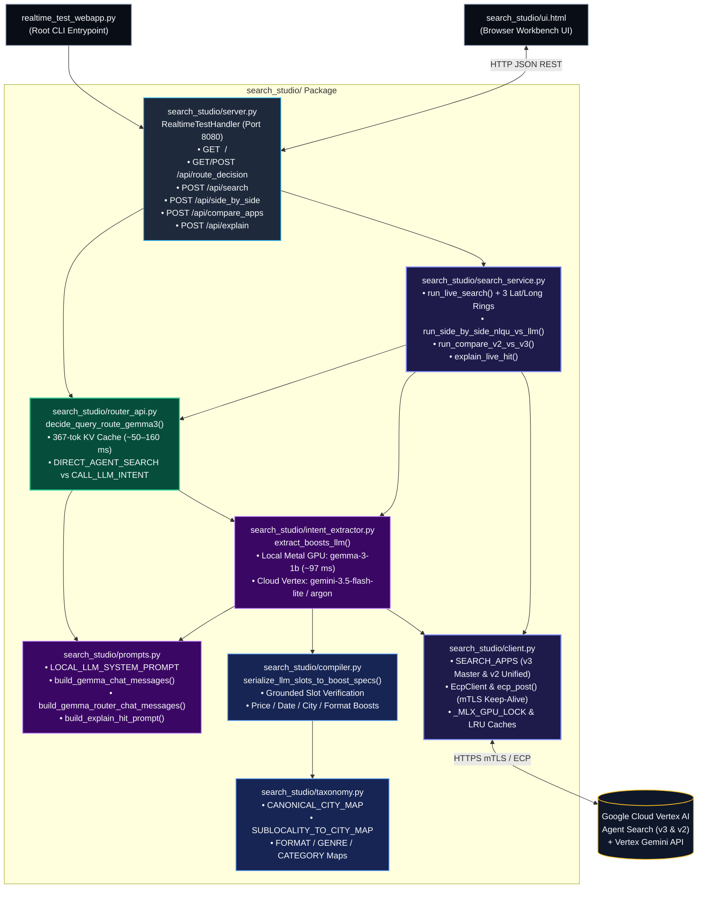

# `search_studio` — Modular Real-Time Entertainment Search & LLM Routing Package

`search_studio` is the modular Python backend and frontend UI package powering the **Entertainment Search Studio** (`http://127.0.0.1:8080`). It decomposes query routing, LLM intent extraction, deterministic `conditionBoostSpecs` compilation, concentric Lat/Long `GEO_DISTANCE` proximity boosting, and Vertex AI Agent Search execution into clean, single-responsibility modules.

---

## 1. Package Directory & File Reference

```text
search_studio/
├── __init__.py            # Public package exports
├── router_api.py          # Step 0: Local Gemma 3 Query Decision Router API (/api/route_decision)
├── intent_extractor.py    # Step 1: Local Apple Metal GPU (mlx-lm) & Cloud Gemini Intent Extractor
├── prompts.py             # LLM System Prompts & multi-turn few-shot chat templates
├── compiler.py            # Step 2: Deterministic Intent-to-Boost & Geolocation Compiler
├── taxonomy.py            # Canonical city, sub-locality, lat/long, format, genre & category maps
├── search_service.py      # Step 3: Vertex AI Search dispatcher, Lat/Long rings & comparators
├── client.py              # Search App registry (v3 vs v2), ECP/mTLS client & runtime locks/caches
├── server.py              # HTTP API Server & Request Handler (RealtimeTestHandler)
└── ui.html                # Dark-Mode Search Studio Frontend UI (Side-by-Side, Single, v2 vs v3)
```

### Detailed Module Breakdown

| File | Lines | Core Responsibility & Key Symbols |
| :--- | :---: | :--- |
| **[`router_api.py`](./router_api.py)** | ~215 | **Local Gemma 3 Decision Router API (`GET / POST /api/route_decision`)**<br>• [`get_or_init_local_mlx_router_runtime()`](./router_api.py): Pre-warms a **367-token** multi-turn KV cache on Apple Metal GPU reusing already-loaded `gemma-3-1b-it-qat-4bit` weights (**0 extra GPU RAM**).<br>• [`decide_query_route_gemma3()`](./router_api.py): Classifies in **~50 ms** (route token only) or **~140 ms** (with JSON reason) whether a query should go **directly to Agent Search (`DIRECT_AGENT_SEARCH`, `call_llm_for_intent=False`)** or **call the LLM Intent Extractor (`CALL_LLM_INTENT`, `call_llm_for_intent=True`)**.<br>• [`handle_route_decision_request()`](./router_api.py): HTTP handler supporting optional `"execute_search": true`. |
| **[`intent_extractor.py`](./intent_extractor.py)** | ~401 | **Python Code for LLM Intent Extraction (Local Metal GPU + Cloud Gemini)**<br>• [`get_or_init_local_mlx_runtime()`](./intent_extractor.py): Loads 4-bit MLX models (`gemma-3-1b-it-qat-4bit`, `gemma-3-270m-it-qat-4bit`, `Qwen2.5-1.5B-Instruct-4bit`, `Qwen2.5-3B-Instruct-4bit`) onto Apple Metal GPU and pre-warms their system prompt KV cache.<br>• [`extract_boosts_local_mlx()`](./intent_extractor.py): Clones the pre-warmed KV cache via `copy.deepcopy()` and streams the compact 8-key JSON intent in **~97 ms** (Gemma 3 1B).<br>• [`extract_boosts_cloud_gemini()`](./intent_extractor.py): Calls Vertex AI `gemini-3.5-flash-lite` (`asia-south1`) or `gemini-4-argon` (`global`) with `thinkingBudget: 0`.<br>• [`extract_boosts_llm()`](./intent_extractor.py): Unified dispatcher across local MLX and Cloud Gemini models. |
| **[`prompts.py`](./prompts.py)** | ~179 | **LLM System Prompts & Multi-Turn Few-Shot Chat Templates**<br>• [`LOCAL_LLM_SYSTEM_PROMPT`](./prompts.py) / [`GEMINI_INTENT_SYSTEM_INSTRUCTION`](./prompts.py): Full schema-grounded 8-key JSON slot extraction prompt (`type`, `city`, `fmt`, `lang`, `genres`, `cats`, `min_price`, `max_price`, `when`, `slots`, `q`).<br>• [`build_gemma_chat_messages()`](./prompts.py): Compact **404-token** multi-turn chat template tailored to Gemma 3's 512-token `RotatingKVCache`.<br>• [`build_gemma_router_chat_messages()`](./prompts.py): Compact **367-token** 5-shot router chat template for `DIRECT_AGENT_SEARCH` vs. `CALL_LLM_INTENT`.<br>• [`build_explain_hit_prompt()`](./prompts.py): Schema-aware prompt (`v3` Session-Grain vs. `v2` Venue-Grain) for `gemini-3.5-flash-lite` live hit diagnosis. |
| **[`compiler.py`](./compiler.py)** | ~1,390 | **Deterministic Intent-to-Boost & Geolocation Compiler**<br>• [`serialize_llm_slots_to_boost_specs()`](./compiler.py): Validates LLM-extracted JSON slots against the raw user query (zero hallucinated cities, prices, or dates) and compiles schema-verified `conditionBoostSpecs` (`record_type`, `regions`, `formats`, `languages`, `genres`, `categories`, `min_price`, `show_dates`, `time_slots`, `is_sold_out`) + hard filters.<br>• [`_normalize_city_and_locality()`](./compiler.py) & [`_build_region_boost_and_geo_city()`](./compiler.py): Maps neighborhoods (`Koramangala` $\rightarrow$ `Bengaluru`, `Lower Parel` $\rightarrow$ `Mumbai`, `Gurgaon`/`Noida` $\rightarrow$ `National Capital Region (NCR)`) and builds `location:GEO_DISTANCE("<City>", 10000)` filters.<br>• [`_parse_price_bounds()`](./compiler.py) & [`_resolve_temporal_ranges()`](./compiler.py): Compiles `between M and N` / `under N` price filters and RFC3339 date/time-slot ranges. |
| **[`taxonomy.py`](./taxonomy.py)** | ~620 | **Facet, Geography, Format, Genre & Category Mappings**<br>• [`CANONICAL_CITY_MAP`](./taxonomy.py), [`SUBLOCALITY_TO_CITY_MAP`](./taxonomy.py), [`GEO_CITY_NAME_MAP`](./taxonomy.py): Canonical Indian city & neighborhood dictionaries.<br>• [`FORMAT_VALUES_V3`](./taxonomy.py), [`FORMAT_SPEC_MAP_V3`](./taxonomy.py), [`FORMAT_SPEC_MAP_V2`](./taxonomy.py): Format mappings (`IMAX`, `IMAX 3D`, `4DX`, `DOLBY`, `SCREENX`, `3D`, `2D`).<br>• [`VALID_GENRES`](./taxonomy.py), [`GENRE_BQ_EXPANSION`](./taxonomy.py), [`VALID_CATEGORIES`](./taxonomy.py), [`VALID_LANGUAGES`](./taxonomy.py), [`ARTIST_NICKNAME_MAP`](./taxonomy.py): Grounding vocabularies verified against BigQuery. |
| **[`search_service.py`](./search_service.py)** | ~663 | **Live Vertex AI Agent Search Execution, Concentric Lat/Long Boosting & Comparisons**<br>• [`run_live_search()`](./search_service.py): Executes live search across `auto_route`, `llm_boost`, `vertex_native` (Managed NLQU), or `none` (BM25 + Hybrid). Injects 3 concentric Lat/Long `GEO_DISTANCE` boost rings (`<= 3 km` `+0.95`, `<= 10 km` `+0.80`, `<= 25 km` `+0.55`) with a `3000 km` guard filter when `user_lat` & `user_lng` are passed, plus automatic 0-hit sub-locality fallback.<br>• [`run_side_by_side_nlqu_vs_llm()`](./search_service.py): Runs Managed Vertex NLQU, Selected Boost LLM, and Gemma 3 Route Decision concurrently on a 3-worker thread pool.<br>• [`run_compare_v2_vs_v3()`](./search_service.py): Runs `v2` (`ent-bq-5stores-v2-app`) and `v3` (`ent-bq-5stores-master-v3-app`) concurrently head-to-head.<br>• [`explain_live_hit()`](./search_service.py), [`build_curl_command()`](./search_service.py), [`_compute_hit_distance_km()`](./search_service.py). |
| **[`client.py`](./client.py)** | ~356 | **Search App Registry, ECP / mTLS HTTP Proxy Client & Runtime State**<br>• [`SEARCH_APPS`](./client.py) & [`get_search_app_config()`](./client.py): Configures `v3` Master (`ent-bq-5stores-master-v3-app`, Session-Grain) and `v2` Unified (`ent-bq-5stores-v2-app`, Venue-Grain).<br>• [`EcpClient`](./client.py) & [`ecp_post()`](./client.py): Keep-alive HTTP client routed through `ecp_http_proxy` (`discoveryengine.mtls.googleapis.com` & `aiplatform.mtls.googleapis.com`) with auto-401 token refresh and exponential backoff.<br>• Holds shared thread/GPU locks (`_MLX_GPU_LOCK`, `_NLU_CACHE_LOCK`) and LRU caches (`_LLM_BOOST_CACHE`, `_ROUTER_DECISION_CACHE`). |
| **[`server.py`](./server.py)** | ~138 | **HTTP API Server & Request Handler (`http://127.0.0.1:8080`)**<br>• [`RealtimeTestHandler`](./server.py): Serves `GET /` ([`ui.html`](./ui.html)), `GET /api/presets`, `GET/POST /api/route_decision`, `POST /api/search`, `POST /api/side_by_side`, `POST /api/compare_apps`, and `POST /api/explain`.<br>• [`main()`](./server.py): Pre-warms local Metal GPU models + Gemma 3 Router KV cache on startup and launches `ThreadingHTTPServer`. |
| **[`ui.html`](./ui.html)** | ~2,049 | **Clean Dark-Mode Search Studio Frontend UI**<br>• Interactive workbench with **Side-by-Side (NLQU vs. LLM Boost)**, **Single Engine Inspector**, and **`v2` vs. `v3` App Comparison** tabs.<br>• Displays the live **Gemma 3 Route Decision Banner** (`⚡ DIRECT_AGENT_SEARCH` vs. `🧠 CALL_LLM_INTENT`), **User GPS Proximity Controls** (preset coordinates + browser geolocation + distance badges), collapsible **cURL / JSON Request Inspector**, and one-click **AI Hit Diagnosis (`✨ Explain`)**. |

---

## 2. Architecture & Module Interaction

### 2.1 Mermaid Module Dependency & Request Flow Diagram



---

### 2.2 End-to-End Request Lifecycle (ASCII Blueprint)

```text
  Browser UI (`search_studio/ui.html`) or API Caller
                         |
                         |  POST /api/search  or  GET/POST /api/route_decision
                         v
  +-----------------------------------------------------------------------------+
  | 1. HTTP Server Layer (`search_studio/server.py`)                            |
  |    • Parses query parameters / JSON body and dispatches to service handlers |
  +-----------------------------------------------------------------------------+
                         |
                         v
  +-----------------------------------------------------------------------------+
  | 2. Gemma 3 Decision Router (`search_studio/router_api.py` + `prompts.py`)   |
  |    • Clones pre-warmed 367-token Gemma 3 1B Router KV cache on Metal GPU    |
  |    • Emits `{"route": "DIRECT_AGENT_SEARCH" | "CALL_LLM_INTENT", ...}`      |
  +-----------------------------------------------------------------------------+
                    /                                         \
   call_llm_for_intent = False                 call_llm_for_intent = True
   ("DIRECT_AGENT_SEARCH")                     ("CALL_LLM_INTENT")
   Pure entity/title query                     Query has city, price, date,
   (0 ms LLM intent overhead)                  format, language, or genre
                  /                                             \
                 |                                               v
                 |             +------------------------------------------------+
                 |             | 3. LLM Intent Extractor                        |
                 |             |    (`search_studio/intent_extractor.py`)       |
                 |             |    • Uses prompts from `prompts.py`            |
                 |             |    • Local MLX Gemma 3 1B (~97 ms) or Gemini   |
                 |             |    • Outputs compact 8-key JSON intent slots   |
                 |             +------------------------------------------------+
                 |                                               |
                 |                                               v
                 |             +------------------------------------------------+
                 |             | 4. Deterministic Boost & Geo Compiler          |
                 |             |    (`search_studio/compiler.py` + `taxonomy.py`)|
                 |             |    • Verifies every slot against query tokens  |
                 |             |    • Compiles `conditionBoostSpecs` & `filter` |
                 |             +------------------------------------------------+
                  \                                             /
                   \___________________     ___________________/
                                       \   /
                                        v v
  +-----------------------------------------------------------------------------+
  | 5. Search Service & Concentric GPS Booster (`search_studio/search_service.py`)|
  |    • Appends 3 concentric `location:GEO_DISTANCE(lat, lng, R)` boost rings  |
  |      (3 km -> +0.95, 10 km -> +0.80, 25 km -> +0.55) + 3000 km guard filter |
  |    • Dispatches via `search_studio/client.py` (`ecp_post`) to Vertex Search |
  |    • Computes Haversine distance (`km away`), rule verdicts & cURL snippet  |
  +-----------------------------------------------------------------------------+
```

---

## 3. Running & Testing `search_studio`

### Start the Server
From the repository root:
```bash
./.venv/bin/python realtime_test_webapp.py
```
Then open **`http://127.0.0.1:8080`** in your browser.

### Example API Calls

#### 1. Gemma 3 Route Decision (`GET /api/route_decision`)
```bash
# Direct entity lookup -> call_llm_for_intent: false
curl -s "http://127.0.0.1:8080/api/route_decision?query=Spider-Man:+No+Way+Home" | jq .

# Multi-constraint query -> call_llm_for_intent: true
curl -s "http://127.0.0.1:8080/api/route_decision?query=concerts+between+1000+and+3000+in+delhi" | jq .
```

#### 2. Live Search with Auto-Routing + Lat/Long Proximity Boosting (`POST /api/search`)
```bash
curl -s -X POST "http://127.0.0.1:8080/api/search" \
  -H "Content-Type: application/json" \
  -d '{
    "query": "IMAX movies",
    "nlu_mode": "auto_route",
    "search_app": "v3",
    "user_lat": 19.0596,
    "user_lng": 72.8295,
    "user_radius_km": 0,
    "page_size": 5
  }' | jq '{route: .route_decision.route, geo_filter: .geo_filter, top_hit: .hits[0]}'
```
